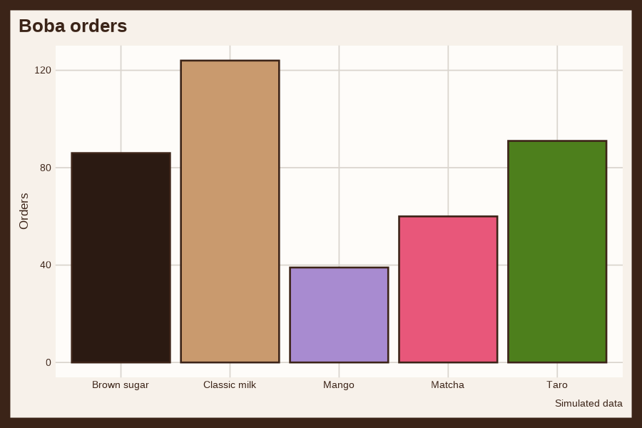
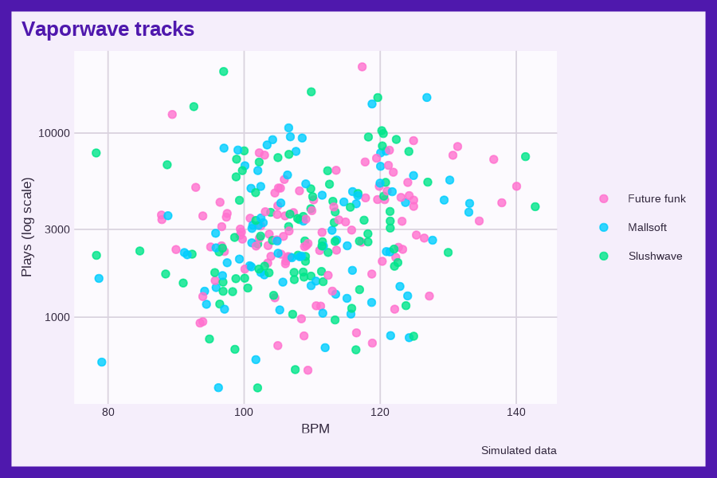

# ggzoomer

<!-- badges: start -->

<!-- badges: end -->

`ggzoomer` is a set of `ggplot2` themes named after Gen Z aesthetics,
trends, and objects. Each palette is checked for contrast and color
vision deficiency.

## Installation

Install the development version from GitHub:

``` r
# install.packages("pak")
pak::pak("mjfrigaard/ggzoomer")
```

## Themes

Each theme is named after an aesthetic, trend, or object from Gen Z
internet culture, and its palette follows how that topic looks to Gen Z
online (its colors, objects, and materials).

| Theme | Wikipedia |
|----|----|
| `theme_airfryer()` | [Convection oven](https://en.wikipedia.org/wiki/Convection_oven) |
| `theme_asmr()` | [ASMR](https://en.wikipedia.org/wiki/ASMR) |
| `theme_axolotl()` | [Axolotl](https://en.wikipedia.org/wiki/Axolotl) |
| `theme_boba()` | [Bubble tea](https://en.wikipedia.org/wiki/Bubble_tea) |
| `theme_capybara()` | [Capybara](https://en.wikipedia.org/wiki/Capybara) |
| `theme_cleangirl()` | [Clean girl aesthetic](https://en.wikipedia.org/wiki/Clean_girl_aesthetic) |
| `theme_coastal()` | [2020s in fashion](https://en.wikipedia.org/wiki/2020s_in_fashion) |
| `theme_coquette()` | [Coquette aesthetic](https://en.wikipedia.org/wiki/Coquette_aesthetic) |
| `theme_cottagecore()` | [Cottagecore](https://en.wikipedia.org/wiki/Cottagecore) |
| `theme_darkacademia()` | [Dark academia](https://en.wikipedia.org/wiki/Dark_academia) |
| `theme_digicam()` | [Digital camera](https://en.wikipedia.org/wiki/Digital_camera) |
| `theme_doomscroll()` | [Doomscrolling](https://en.wikipedia.org/wiki/Doomscrolling) |
| `theme_egirl()` | [E-girl and e-boy subculture](https://en.wikipedia.org/wiki/E-girl_and_e-boy_subculture) |
| `theme_fidget()` | [Fidget toy](https://en.wikipedia.org/wiki/Fidget_toy) |
| `theme_frog()` | [Frog](https://en.wikipedia.org/wiki/Frog) |
| `theme_frutigeraero()` | [Frutiger Aero](https://en.wikipedia.org/wiki/Frutiger_Aero) |
| `theme_goblincore()` | [Goblincore](https://en.wikipedia.org/wiki/Goblincore) |
| `theme_gorpcore()` | [Gorpcore](https://en.wikipedia.org/wiki/Gorpcore) |
| `theme_groupchat()` | [Online chat](https://en.wikipedia.org/wiki/Online_chat) |
| `theme_indiesleaze()` | [Indie sleaze](https://en.wikipedia.org/wiki/Indie_sleaze) |
| `theme_kidcore()` | [Kidcore](https://en.wikipedia.org/wiki/Kidcore) |
| `theme_ledstrip()` | [LED strip light](https://en.wikipedia.org/wiki/LED_strip_light) |
| `theme_liminal()` | [Liminal space](https://en.wikipedia.org/wiki/Liminal_space) |
| `theme_livestream()` | [Live streaming](https://en.wikipedia.org/wiki/Live_streaming) |
| `theme_matcha()` | [Matcha](https://en.wikipedia.org/wiki/Matcha) |
| `theme_mermaidcore()` | [Mermaid](https://en.wikipedia.org/wiki/Mermaid) |
| `theme_photodump()` | [Camera phone](https://en.wikipedia.org/wiki/Camera_phone) |
| `theme_plushie()` | [Stuffed toy](https://en.wikipedia.org/wiki/Stuffed_toy) |
| `theme_slime()` | [Slime (toy)](https://en.wikipedia.org/wiki/Slime_(toy)) |
| `theme_thrift()` | [Charity shop](https://en.wikipedia.org/wiki/Charity_shop) |
| `theme_tumbler()` | [Vacuum flask](https://en.wikipedia.org/wiki/Vacuum_flask) |
| `theme_unboxing()` | [Unboxing](https://en.wikipedia.org/wiki/Unboxing) |
| `theme_vaporwave()` | [Vaporwave](https://en.wikipedia.org/wiki/Vaporwave) |
| `theme_vinyl()` | [Phonograph record](https://en.wikipedia.org/wiki/Phonograph_record) |
| `theme_voicenote()` | [Voicemail](https://en.wikipedia.org/wiki/Voicemail) |
| `theme_weirdcore()` | [Weirdcore](https://en.wikipedia.org/wiki/Weirdcore) |
| `theme_wiredbuds()` | [Headphones](https://en.wikipedia.org/wiki/Headphones) |

The two graphs below use `theme_boba()` and `theme_vaporwave()` with
simulated data.

``` r
library(ggzoomer)
library(ggplot2)
showtext::showtext_auto()
set.seed(1980)
boba <- data.frame(flavor = sample(c("Classic milk", "Taro", "Brown sugar", "Matcha", "Mango"), 400, replace = TRUE,
  prob = c(0.3, 0.2, 0.25, 0.15, 0.1)))
ggplot(boba, aes(x = flavor, fill = flavor)) +
  geom_bar(show.legend = FALSE) +
  labs(title = "Boba orders", caption = "Simulated data", x = NULL, y = "Orders") +
  theme_boba(base_size = 13)
```



``` r
set.seed(1984)
tracks <- data.frame(bpm = rnorm(300, 110, 12))
tracks$plays <- round(rlnorm(300, meanlog = 8 + 0.01 * (tracks$bpm - 110), sdlog = 0.7))
tracks$mood <- sample(c("Mallsoft", "Future funk", "Slushwave"), 300, replace = TRUE)
ggplot(tracks, aes(x = bpm, y = plays, colour = mood)) +
  geom_point(alpha = 0.8) +
  scale_y_log10() +
  labs(title = "Vaporwave tracks", caption = "Simulated data", x = "BPM", y = "Plays (log scale)", colour = NULL) +
  theme_vaporwave(base_size = 13)
```



## Reference images

Each theme links its Wikipedia article. A freely licensed image (public
domain, CC0, CC BY, CC BY-SA, or GFDL) from the article, or from
Wikimedia Commons when the article has no free image, illustrates it.
The [themes
vignette](https://mjfrigaard.github.io/ggzoomer/articles/themes.html)
shows each image with its author and license.

## Related packages

The 90s themes from earlier versions live in
[ggrewindr](https://github.com/mjfrigaard/ggrewindr), and the helpers
for [*ggplot2: field manual*](https://mjfrigaard.github.io/fm-ggp2/)
live in [fmutils](https://github.com/mjfrigaard/fmutils).
