# Themes

Each `fmggp2` theme is named after an aesthetic, trend, or object from
Gen Z internet culture. Every palette follows the colors, objects, and
materials the topic’s Wikipedia article describes (or the closest
article when the topic doesn’t have one). Each section below shows a
freely licensed image from the article and simulated data to match.

Themes with a dark background also have a light version. Set
`mode = "light"` to get a light background with darker text and marks.
Dark is the default. Each dark theme’s section below shows both
versions.

``` r

library(fmggp2)
library(ggplot2)
showtext::showtext_auto()
```

## Air fryer

[`theme_airfryer()`](https://mjfrigaard.github.io/fmggp2/reference/theme_airfryer.md):
Air fryers are small countertop convection ovens that blow hot air
around food (see [Convection
oven](https://en.wikipedia.org/wiki/Convection_oven) on Wikipedia). The
palette follows the article’s fan forced hot air and browned food:
golden fries, crispy brown, heating element orange, brushed steel, matte
black, and herbs. The image shows an air fryer basket of reheated
potatoes on a kitchen counter.


Image: I am R., [Wikimedia
Commons](https://commons.wikimedia.org/wiki/File:Air_Fryer_2020.jpg), CC
BY 2.0.

``` r

set.seed(2020)
fryer <- data.frame(food = rep(c("Fries", "Wings", "Nuggets", "Veggies"), each = 80))
fryer$minutes <- round(rnorm(320, mean = c(Fries = 15, Wings = 22, Nuggets = 10, Veggies = 12)[fryer$food], sd = 2.5), 1)
ggplot(fryer, aes(x = food, y = minutes, fill = food)) +
  geom_boxplot(show.legend = FALSE) +
  labs(title = "Air fryer cook times", caption = "Simulated data", x = NULL, y = "Minutes") +
  theme_airfryer(base_size = 13)
```


## ASMR

[`theme_asmr()`](https://mjfrigaard.github.io/fmggp2/reference/theme_asmr.md):
ASMR (autonomous sensory meridian response) is the tingling some people
feel while watching whisper, tapping, and crinkle videos (see
[ASMR](https://en.wikipedia.org/wiki/ASMR) on Wikipedia). The palette
follows the article’s soft triggers (whispers, light touch, brushing) as
calm blues, lilac, blush, and mint, with the deep blue of its tingle
map. The image shows a body map showing where ASMR tingles start and
spread.


Image: Emma L. Barratt, Nick J. Davis, [Wikimedia
Commons](https://commons.wikimedia.org/wiki/File:ASMR_Map.png), CC BY
4.0.

``` r

set.seed(2010)
asmr <- data.frame(trigger = rep(c("Whispering", "Tapping", "Crinkling"), each = 200))
asmr$minutes <- rlnorm(600, meanlog = c(Whispering = 3, Tapping = 2.6, Crinkling = 2.3)[asmr$trigger], sdlog = 0.5)
ggplot(asmr, aes(x = minutes, fill = trigger)) +
  geom_density(alpha = 2/3) +
  labs(title = "ASMR watch time", caption = "Simulated data", x = "Minutes watched", fill = NULL) +
  theme_asmr(base_size = 13)
```


## Axolotl

[`theme_axolotl()`](https://mjfrigaard.github.io/fmggp2/reference/theme_axolotl.md):
Axolotls are Mexican salamanders that keep their gills for life and
became an internet favorite (and a game mob) (see
[Axolotl](https://en.wikipedia.org/wiki/Axolotl) on Wikipedia). The
palette follows the article’s color variants: the wild type’s brown with
gold speckles and an olive undertone, the leucistic pink, pink gills,
and the dark melanoid. The image shows a wild type axolotl resting on
gravel in an aquarium.


Image: LoKiLeCh, [Wikimedia
Commons](https://commons.wikimedia.org/wiki/File:Axolotl_ganz.jpg), CC
BY-SA 3.0.

``` r

set.seed(1864)
axolotls <- data.frame(morph = rep(c("Wild type", "Leucistic", "Golden albino"), each = 120))
axolotls$length <- rnorm(360, mean = c("Wild type" = 23, Leucistic = 21, "Golden albino" = 20)[axolotls$morph], sd = 3)
ggplot(axolotls, aes(x = morph, y = length, fill = morph)) +
  geom_violin(alpha = 2/3, show.legend = FALSE) +
  labs(title = "Axolotl lengths", caption = "Simulated data", x = NULL, y = "Length (cm)") +
  theme_axolotl(base_size = 13)
```


## Boba

[`theme_boba()`](https://mjfrigaard.github.io/fmggp2/reference/theme_boba.md):
Bubble tea (boba) is a Taiwanese tea drink with chewy tapioca pearls
(see [Bubble tea](https://en.wikipedia.org/wiki/Bubble_tea) on
Wikipedia). The palette follows the article’s drinks and toppings:
tapioca pearls, pearl black milk tea, pearl green milk tea, red bean,
brown sugar syrup, and taro. The image shows a cup of milk tea with
black tapioca pearls.


Image: Howief, [Wikimedia
Commons](https://commons.wikimedia.org/wiki/File:Bubble_Tea.png), CC
BY-SA 3.0.

``` r

set.seed(1980)
boba <- data.frame(flavor = sample(c("Classic milk", "Taro", "Brown sugar", "Matcha", "Mango"), 400, replace = TRUE,
  prob = c(0.3, 0.2, 0.25, 0.15, 0.1)))
ggplot(boba, aes(x = flavor, fill = flavor)) +
  geom_bar(show.legend = FALSE) +
  labs(title = "Boba orders", caption = "Simulated data", x = NULL, y = "Orders") +
  theme_boba(base_size = 13)
```


## Capybara

[`theme_capybara()`](https://mjfrigaard.github.io/fmggp2/reference/theme_capybara.md):
Capybaras are the largest living rodents and a famously calm internet
mascot (see [Capybara](https://en.wikipedia.org/wiki/Capybara) on
Wikipedia). The palette follows the article’s reddish brown back and
yellowish brown belly, plus the scarlet ibis, green anaconda, river
water, and dark mud of its habitat. The image shows a capybara standing
on a sandy riverbank.


Image: Giles Laurent, [Wikimedia
Commons](https://commons.wikimedia.org/wiki/File:Capybaracropped.jpg),
CC BY-SA 4.0.

``` r

set.seed(1766)
capys <- data.frame(hour = 0:23)
capys$Grazing <- round(20 + 15 * sin((capys$hour - 6) / 24 * 2 * pi) + rnorm(24, 0, 2))
capys$Swimming <- round(10 + 8 * sin((capys$hour - 10) / 24 * 2 * pi) + rnorm(24, 0, 2))
capys <- reshape(capys, direction = "long", varying = c("Grazing", "Swimming"), v.names = "minutes",
  timevar = "activity", times = c("Grazing", "Swimming"))
ggplot(capys, aes(x = hour, y = minutes, colour = activity)) +
  geom_line(linewidth = 1) +
  labs(title = "A capybara's day", caption = "Simulated data", x = "Hour", y = "Minutes", colour = NULL) +
  theme_capybara(base_size = 13)
```


## Clean girl

[`theme_cleangirl()`](https://mjfrigaard.github.io/fmggp2/reference/theme_cleangirl.md):
The clean girl aesthetic is a minimal beauty and wellness trend built on
slicked back hair, a no makeup makeup look, and a limited palette (see
[Clean girl
aesthetic](https://en.wikipedia.org/wiki/Clean_girl_aesthetic) on
Wikipedia). The palette follows the article’s no makeup makeup look
(heavy rosy blush, perfect brows, brown lip liner), its whites, blacks,
grays, and light neutrals, and the matcha it mentions. The image shows a
single small gold hoop earring.


Image: Silar, [Wikimedia
Commons](https://commons.wikimedia.org/wiki/File:02024_0697_8_mm_diameter_gold_hoop_earring.jpg),
CC BY-SA 4.0.

``` r

set.seed(2022)
routine <- data.frame(step = rep(c("Cleanser", "Serum", "Moisturizer", "Sunscreen"), each = 150))
routine$minutes <- rgamma(600, shape = c(Cleanser = 4, Serum = 2, Moisturizer = 3, Sunscreen = 2)[routine$step], rate = 2)
routine$step <- factor(routine$step, levels = c("Cleanser", "Serum", "Moisturizer", "Sunscreen"))
ggplot(routine, aes(x = minutes, fill = step)) +
  geom_histogram(bins = 30) +
  labs(title = "Morning routine", caption = "Simulated data", x = "Minutes per step", fill = NULL) +
  theme_cleangirl(base_size = 13)
```


## Coastal grandmother

[`theme_coastal()`](https://mjfrigaard.github.io/fmggp2/reference/theme_coastal.md):
Coastal grandmother is a relaxed style of linen, beach houses, and
seaside cooking (see [Coastal
grandmother](https://en.wikipedia.org/wiki/Coastal_grandmother) on
Wikipedia). The palette follows a linen beach house: sea blue, navy,
sand, hydrangea, seagrass, and driftwood (the article has no palette, so
the Cape Cod postcard leads). The image shows a vintage postcard of the
bath houses on Craigville Beach, Cape Cod.


Image: Tichnor Bros. Inc., Boston, Mass., [Wikimedia
Commons](https://commons.wikimedia.org/wiki/File:Bath_house_and_beach_at_Craigville_Beach,_Cape_Cod,_Mass_(66011).jpg),
Public domain.

``` r

set.seed(2022)
beach <- data.frame(month = factor(rep(month.abb[5:9], each = 3), levels = month.abb[5:9]),
  activity = rep(c("Beach walks", "Farmers market", "Cooking"), 5))
beach$hours <- round(runif(15, 4, 20))
ggplot(beach, aes(x = month, y = hours, fill = activity)) +
  geom_col() +
  labs(title = "Summer on the coast", caption = "Simulated data", x = NULL, y = "Hours", fill = NULL) +
  theme_coastal(base_size = 13)
```


## Coquette

[`theme_coquette()`](https://mjfrigaard.github.io/fmggp2/reference/theme_coquette.md):
The coquette aesthetic is a 2020s fashion trend of bows, lace, ribbons,
and pastels (see [Coquette
aesthetic](https://en.wikipedia.org/wiki/Coquette_aesthetic) on
Wikipedia). The palette follows the article’s bows, lace, pastel colors,
and pink clothing: ballet pink, ribbon red, powder blue, lilac, deep
rose, and pearl gray. The image shows an 1880s tobacco card portrait of
Marie Antoinette.


Image: Kinney Brothers Tobacco Company, [Wikimedia
Commons](https://commons.wikimedia.org/wiki/File:Marie_Antoinette,_from_Leaders_series_(N222)_issued_by_Kinney_Bros._MET_DPB872310.jpg),
CC0.

``` r

set.seed(1770)
bows <- data.frame(fabric = sample(c("Satin", "Velvet", "Lace", "Tulle", "Chiffon"), 300, replace = TRUE),
  item = sample(c("Hair bow", "Ribbon", "Lace top"), 300, replace = TRUE))
ggplot(bows, aes(x = item, fill = fabric)) +
  geom_bar(position = "dodge") +
  labs(title = "Coquette closet", caption = "Simulated data", x = NULL, y = "Items", fill = NULL) +
  theme_coquette(base_size = 13)
```


## Cottagecore

[`theme_cottagecore()`](https://mjfrigaard.github.io/fmggp2/reference/theme_cottagecore.md):
Cottagecore is an internet aesthetic that romanticizes rural life:
gardens, baking, and handmade things (see
[Cottagecore](https://en.wikipedia.org/wiki/Cottagecore) on Wikipedia).
The palette follows the article’s muted palettes, floral prints, calico,
worn leather, and indoor greenery: sage, rose, leather brown, calico
blue, butter yellow, and moss. The image shows Anne Hathaway’s Cottage,
a thatched cottage and garden in Warwickshire.


Image: Tony Hisgett from Birmingham, UK, [Wikimedia
Commons](https://commons.wikimedia.org/wiki/File:Anne_Hathaways_Cottage_1_(5662418953).jpg),
CC BY 2.0.

``` r

set.seed(2018)
garden <- data.frame(week = rep(1:12, 3), crop = rep(c("Tomatoes", "Herbs", "Strawberries"), each = 12))
garden$harvest <- round(pmax(0, c(Tomatoes = 1.2, Herbs = 0.6, Strawberries = 0.9)[garden$crop] * garden$week + rnorm(36, 0, 1.5)), 1)
ggplot(garden, aes(x = week, y = harvest, colour = crop)) +
  geom_line(linewidth = 1) +
  geom_point() +
  labs(title = "Cottage garden harvest", caption = "Simulated data", x = "Week", y = "Harvest (lbs)", colour = NULL) +
  theme_cottagecore(base_size = 13)
```


## Dark academia

[`theme_darkacademia()`](https://mjfrigaard.github.io/fmggp2/reference/theme_darkacademia.md):
Dark academia is an internet aesthetic built around old libraries,
tweed, and classic literature (see [Dark
academia](https://en.wikipedia.org/wiki/Dark_academia) on Wikipedia).
The palette follows the article’s palette of black, white, beige,
browns, dark green, and occasionally navy blue, with candlelight gold
and dark wood. The image shows a Gothic spiral staircase inside
St. Barbara’s Church in Kutna Hora.


Image: Txllxt TxllxT, [Wikimedia
Commons](https://commons.wikimedia.org/wiki/File:Kutn%C3%A1_Hora_-_View_North_on_Gothic_spiral_staircase.jpg),
CC BY-SA 4.0.

``` r

set.seed(1891)
books <- data.frame(genre = rep(c("Poetry", "Gothic novels", "Philosophy", "Greek myths"), each = 100))
books$pages <- round(rnorm(400, mean = c(Poetry = 120, "Gothic novels" = 380, Philosophy = 260, "Greek myths" = 320)[books$genre], sd = 50))
ggplot(books, aes(x = pages, y = genre, fill = genre)) +
  geom_boxplot(show.legend = FALSE) +
  labs(title = "The reading list", caption = "Simulated data", x = "Pages", y = NULL) +
  theme_darkacademia(base_size = 13)
```


With `mode = "light"`:

``` r

last_plot() + theme_darkacademia(base_size = 13, mode = "light")
```


## Digicam

[`theme_digicam()`](https://mjfrigaard.github.io/fmggp2/reference/theme_digicam.md):
Digital point and shoot cameras from the 2000s are back for their flash
heavy, slightly blurry photos (see [Digital
camera](https://en.wikipedia.org/wiki/Digital_camera) on Wikipedia). The
palette follows the article’s sensor channels (red, green, and blue), an
LCD screen, the flash, and the black grip on a silver body. The image
shows the front and back of a Canon PowerShot A95.


Image: Fir0002 (composite version by Matt57), [Wikimedia
Commons](https://commons.wikimedia.org/wiki/File:Canon_PowerShot_A95_-_front_and_back.jpg),
GFDL 1.2.

``` r

set.seed(2004)
cams <- data.frame(megapixels = round(runif(250, 2, 12), 1))
cams$price <- round(40 + 6 * cams$megapixels + rnorm(250, 0, 15))
cams$condition <- sample(c("Like new", "Used", "Scratched"), 250, replace = TRUE)
ggplot(cams, aes(x = megapixels, y = price, colour = condition)) +
  geom_point(size = 2, alpha = 0.8) +
  labs(title = "Resale digicams", caption = "Simulated data", x = "Megapixels", y = "Price ($)", colour = NULL) +
  theme_digicam(base_size = 13)
```


## Doomscroll

[`theme_doomscroll()`](https://mjfrigaard.github.io/fmggp2/reference/theme_doomscroll.md):
Doomscrolling is spending far too long scrolling through upsetting or
endless feeds (see
[Doomscrolling](https://en.wikipedia.org/wiki/Doomscrolling) on
Wikipedia). The palette follows the article’s late night feeds of
negative news: screen glow blue, alert red, headline gray, notification
orange, purple, and cyan on a dark room. The image shows a thumb
scrolling a phone screen in the dark.


Image: Japanexperterna.se, [Wikimedia
Commons](https://commons.wikimedia.org/wiki/File:Scrolling_on_phone_(cropped_again).jpg),
CC BY-SA 2.0.

``` r

set.seed(2020)
scroll <- data.frame(hour = rep(0:23, 2), day = rep(c("Weekday", "Weekend"), each = 24))
scroll$minutes <- round(pmax(0, 25 + 20 * cos((scroll$hour - 23) / 24 * 2 * pi) + ifelse(scroll$day == "Weekend", 10, 0) + rnorm(48, 0, 4)))
ggplot(scroll, aes(x = hour, y = minutes, fill = day)) +
  geom_area(alpha = 0.8, position = "identity") +
  labs(title = "Late night doomscrolling", caption = "Simulated data", x = "Hour", y = "Minutes", fill = NULL) +
  theme_doomscroll(base_size = 13)
```


With `mode = "light"`:

``` r

last_plot() + theme_doomscroll(base_size = 13, mode = "light")
```


## Fidget toy

[`theme_fidget()`](https://mjfrigaard.github.io/fmggp2/reference/theme_fidget.md):
Fidget toys (spinners, cubes, pop its, and bike chains) are small things
to keep your hands busy (see [Fidget
toy](https://en.wikipedia.org/wiki/Fidget_toy) on Wikipedia). The
palette follows the article’s fidget spinners, Fidget Cubes, and Pop
Its: saturated silicone colors and a chrome bearing gray. The image
shows a bike chain fidget toy on lined paper.


Image: Ike9898, [Wikimedia
Commons](https://commons.wikimedia.org/wiki/File:A_%22bike_chain%22_type_fidget_toy.jpg),
CC BY-SA 4.0.

``` r

set.seed(2017)
spins <- data.frame(toy = rep(c("Spinner", "Cube", "Pop it", "Bike chain"), each = 100))
spins$seconds <- rexp(400, rate = c(Spinner = 1 / 60, Cube = 1 / 30, "Pop it" = 1 / 45, "Bike chain" = 1 / 20)[spins$toy])
ggplot(spins, aes(x = toy, y = seconds, colour = toy)) +
  geom_jitter(width = 0.2, alpha = 0.6, show.legend = FALSE) +
  labs(title = "How long a fidget lasts", caption = "Simulated data", x = NULL, y = "Seconds") +
  theme_fidget(base_size = 13)
```


## Frog

[`theme_frog()`](https://mjfrigaard.github.io/fmggp2/reference/theme_frog.md):
Frogs are tailless amphibians and a cottagecore and goblincore icon (see
[Frog](https://en.wikipedia.org/wiki/Frog) on Wikipedia). The palette
follows the article’s skin colors: camouflage green and dappled brown,
warning red or yellow and black, and the blue flanks of the red eyed
tree frog. The image shows a red eyed tree frog on a branch.


Image: Charlie Jackson, [Wikimedia
Commons](https://commons.wikimedia.org/wiki/File:Red-eyed_Leaf_Frog_(49661076226).jpg),
CC BY 2.0.

``` r

set.seed(1758)
frogs <- data.frame(species = rep(c("Tree frog", "Bullfrog", "Poison dart"), each = 150))
frogs$jump <- rnorm(450, mean = c("Tree frog" = 1.5, Bullfrog = 2, "Poison dart" = 0.6)[frogs$species], sd = 0.3)
ggplot(frogs, aes(x = jump, fill = species)) +
  geom_histogram(bins = 30, alpha = 0.8, position = "identity") +
  labs(title = "Frog jumps", caption = "Simulated data", x = "Jump distance (m)", fill = NULL) +
  theme_frog(base_size = 13)
```


## Frutiger Aero

[`theme_frutigeraero()`](https://mjfrigaard.github.io/fmggp2/reference/theme_frutigeraero.md):
Frutiger Aero is the glossy design style of the mid 2000s: bubbles,
water, grass, and blue skies (see [Frutiger
Aero](https://en.wikipedia.org/wiki/Frutiger_Aero) on Wikipedia). The
palette follows the article’s blue skies, grass, aurorae, and bright
colors (“yellows, and particularly blues and greens”). The image shows
soap bubbles floating over sunlit grass.


Image: ThePixelman on Pixabay, [Wikimedia
Commons](https://commons.wikimedia.org/wiki/File:Frutiger_Aero_Bubbles_And_Grass.jpg),
CC0.

``` r

set.seed(2007)
aero <- data.frame(year = 2004:2013)
aero$Gloss <- round(100 * plogis((aero$year - 2007) * 1.2) * (1 - plogis((aero$year - 2011) * 1.5)))
aero$Flat <- round(100 * plogis((aero$year - 2011) * 1.5))
aero <- reshape(aero, direction = "long", varying = c("Gloss", "Flat"), v.names = "share", timevar = "style", times = c("Gloss", "Flat"))
ggplot(aero, aes(x = year, y = share, colour = style)) +
  geom_line(linewidth = 1.2) +
  labs(title = "Gloss to flat", caption = "Simulated data", x = NULL, y = "Share of app icons (%)", colour = NULL) +
  theme_frutigeraero(base_size = 13)
```


## Goblincore

[`theme_goblincore()`](https://mjfrigaard.github.io/fmggp2/reference/theme_goblincore.md):
Goblincore celebrates the less pretty side of nature: moss, mushrooms,
snails, and found objects (see
[Goblincore](https://en.wikipedia.org/wiki/Goblincore) on Wikipedia).
The palette follows the article’s brown, green, and clashing colors:
moss, mushroom caps, earthworms, bones, rocks, and soil. The image shows
a still life of old vases, a framed photo, and an animal skull.


Image: Bart Everson, [Wikimedia
Commons](https://commons.wikimedia.org/wiki/File:Still_life_with_animal_skull_and_vases.jpg),
CC BY 2.0.

``` r

set.seed(2019)
finds <- data.frame(find = sample(c("Mushrooms", "Moss", "Snail shells", "Bones", "Shiny rocks"), 300, replace = TRUE,
  prob = c(0.3, 0.25, 0.2, 0.1, 0.15)))
finds$find <- factor(finds$find, levels = names(sort(table(finds$find))))
ggplot(finds, aes(y = find, fill = find)) +
  geom_bar(show.legend = FALSE) +
  labs(title = "Forest walk finds", caption = "Simulated data", x = "Count", y = NULL) +
  theme_goblincore(base_size = 13)
```


With `mode = "light"`:

``` r

last_plot() + theme_goblincore(base_size = 13, mode = "light")
```


## Gorpcore

[`theme_gorpcore()`](https://mjfrigaard.github.io/fmggp2/reference/theme_gorpcore.md):
Gorpcore is hiking gear (shell jackets, fleece, and trail shoes) worn as
everyday streetwear (see
[Gorpcore](https://en.wikipedia.org/wiki/Gorpcore) on Wikipedia). The
palette follows the article’s two color schemes, earthy or bright and
bold: safety orange, glacier blue, forest green, khaki, lime, and
charcoal shell jackets. The image shows outdoor jackets and pants
hanging in a store.


Image: Joe Parks from Berkeley, CA, [Wikimedia
Commons](https://commons.wikimedia.org/wiki/File:The_North_Face_Outdoor_Sportswear_-_Flickr_-_Joe_Parks_(cropped).jpg),
CC BY 2.0.

``` r

set.seed(2017)
gear <- data.frame(item = rep(c("Shell jacket", "Fleece", "Trail shoes"), each = 120))
gear$price <- rlnorm(360, meanlog = log(c("Shell jacket" = 250, Fleece = 120, "Trail shoes" = 140)[gear$item]), sdlog = 0.25)
ggplot(gear, aes(x = price, fill = item)) +
  geom_density(alpha = 2/3) +
  labs(title = "Gorpcore price tags", caption = "Simulated data", x = "Price ($)", fill = NULL) +
  theme_gorpcore(base_size = 13)
```


## Group chat

[`theme_groupchat()`](https://mjfrigaard.github.io/fmggp2/reference/theme_groupchat.md):
Group chats are where friends plan, share memes, and leave each other on
read (see [Online chat](https://en.wikipedia.org/wiki/Online_chat) on
Wikipedia). The palette follows chat bubbles from the article’s instant
messengers: sent blue, received gray, text green, typing purple,
reaction yellow, and unread red. The image shows a group conversation in
a messaging app.


Image: Sublime Software Ltd., [Wikimedia
Commons](https://commons.wikimedia.org/wiki/File:Screenshot_of_Briar_04_private_group.png),
CC BY 4.0.

``` r

set.seed(2009)
chat <- data.frame(friend = rep(c("Ari", "Bo", "Cam", "Dev", "Eli"), each = 7), day = rep(1:7, 5))
chat$messages <- rpois(35, lambda = c(Ari = 60, Bo = 15, Cam = 35, Dev = 5, Eli = 25)[chat$friend])
ggplot(chat, aes(x = day, y = messages, fill = friend)) +
  geom_col() +
  labs(title = "Who carries the group chat", caption = "Simulated data", x = "Day", y = "Messages", fill = NULL) +
  theme_groupchat(base_size = 13)
```


## Indie sleaze

[`theme_indiesleaze()`](https://mjfrigaard.github.io/fmggp2/reference/theme_indiesleaze.md):
Indie sleaze is the messy, flash photo party style of 2006 to 2012, now
back on social media (see [Indie
sleaze](https://en.wikipedia.org/wiki/Indie_sleaze) on Wikipedia). The
palette follows the article’s flash photography, bleached hair, shredded
denim, galaxy and “Aztec” prints, and smudged eyeliner on a dark club
floor. The image shows a singer performing under a stage light in 2007.


Image: Dale Harvey, [Wikimedia
Commons](https://commons.wikimedia.org/wiki/File:Pete_doherty_2007.jpg),
CC BY 2.0.

``` r

set.seed(2007)
shows <- data.frame(venue = rep(c("Basement", "Club", "Festival"), each = 150))
shows$minutes <- rnorm(450, mean = c(Basement = 35, Club = 55, Festival = 75)[shows$venue], sd = 10)
ggplot(shows, aes(x = venue, y = minutes, fill = venue)) +
  geom_violin(show.legend = FALSE) +
  labs(title = "Set lengths", caption = "Simulated data", x = NULL, y = "Minutes") +
  theme_indiesleaze(base_size = 13)
```


With `mode = "light"`:

``` r

last_plot() + theme_indiesleaze(base_size = 13, mode = "light")
```


## Kidcore

[`theme_kidcore()`](https://mjfrigaard.github.io/fmggp2/reference/theme_kidcore.md):
Kidcore is a bright, nostalgic aesthetic of primary colors, beads,
stickers, and childhood toys (see
[Kidcore](https://en.wikipedia.org/wiki/Kidcore) on Wikipedia). The
palette follows the article’s bright primary colors and rainbow colours.
The image shows a heart shaped rainbow bead necklace.


Image: Brainy J, [Wikimedia
Commons](https://commons.wikimedia.org/wiki/File:Rainbow_bead_necklace_-_heart_shaped.jpg),
CC0.

``` r

set.seed(2001)
beads <- data.frame(color = sample(c("Red", "Yellow", "Blue", "Green", "Orange", "Purple"), 600, replace = TRUE))
beads$color <- factor(beads$color, levels = c("Red", "Yellow", "Blue", "Green", "Orange", "Purple"))
beads$kit <- sample(c("Bracelet", "Necklace"), 600, replace = TRUE)
ggplot(beads, aes(x = kit, fill = color)) +
  geom_bar(position = "fill") +
  labs(title = "Bead kit colors", caption = "Simulated data", x = NULL, y = "Share of beads", fill = NULL) +
  theme_kidcore(base_size = 13)
```


## LED strip

[`theme_ledstrip()`](https://mjfrigaard.github.io/fmggp2/reference/theme_ledstrip.md):
LED strip lights are the adhesive color changing lights that line
bedroom ceilings and desks (see [LED strip
light](https://en.wikipedia.org/wiki/LED_strip_light) on Wikipedia). The
palette follows the article’s strip types: red, green, and blue
multicolor LEDs, warm and cool white color temperatures, and a 2200K
amber. The image shows a strip of cyan LED light under an airplane cabin
shelf.


Image: Matti Blume, [Wikimedia
Commons](https://commons.wikimedia.org/wiki/File:Passenger_Experience_Week_2018,_Hamburg_(1X7A3748).jpg),
CC BY-SA 4.0.

``` r

set.seed(2016)
leds <- data.frame(setting = sample(c("Static", "Fade", "Music sync", "Rainbow", "Sunset"), 300, replace = TRUE,
  prob = c(0.25, 0.3, 0.15, 0.2, 0.1)))
leds$hours <- rgamma(300, shape = 3, rate = 0.8)
ggplot(leds, aes(x = setting, y = hours, fill = setting)) +
  geom_boxplot(show.legend = FALSE) +
  labs(title = "LED strip settings", caption = "Simulated data", x = NULL, y = "Hours on per night") +
  theme_ledstrip(base_size = 13)
```


With `mode = "light"`:

``` r

last_plot() + theme_ledstrip(base_size = 13, mode = "light")
```


## Lightstick

[`theme_lightstick()`](https://mjfrigaard.github.io/fmggp2/reference/theme_lightstick.md):
Lightsticks are the glow sticks fans wave at concerts, now synced to the
show at K-pop tours (see [Glow
stick](https://en.wikipedia.org/wiki/Glow_stick) on Wikipedia). The
palette follows the article’s chemiluminescent glow in a translucent
plastic tube: green, pink, blue, yellow, orange, and purple on a black
arena. The image shows a diagram of a glow stick being snapped and lit.

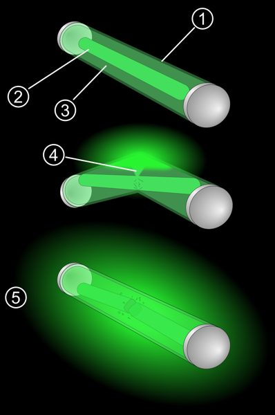

Image: Pbroks13, [Wikimedia
Commons](https://commons.wikimedia.org/wiki/File:Glowstick.svg), CC BY
3.0.

``` r

set.seed(2023)
glow <- data.frame(minute = rep(seq(0, 180, by = 10), 3), stick = rep(c("Premium", "Standard", "Dollar store"), each = 19))
glow$brightness <- 100 * exp(-glow$minute / c(Premium = 200, Standard = 120, "Dollar store" = 60)[glow$stick]) + rnorm(57, 0, 2)
ggplot(glow, aes(x = minute, y = brightness, colour = stick)) +
  geom_line(linewidth = 1.2) +
  labs(title = "Lightstick glow", caption = "Simulated data", x = "Minutes after snapping", y = "Brightness (%)", colour = NULL) +
  theme_lightstick(base_size = 13)
```

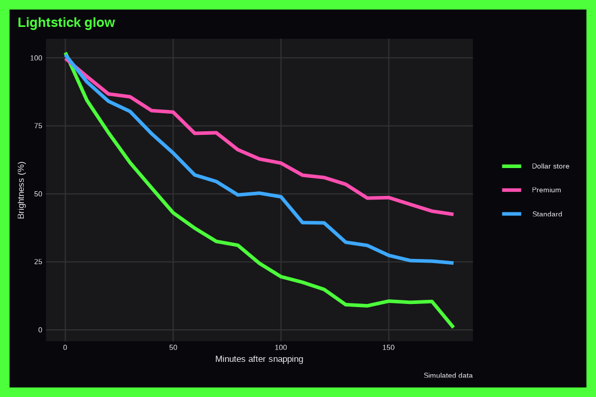

With `mode = "light"`:

``` r

last_plot() + theme_lightstick(base_size = 13, mode = "light")
```

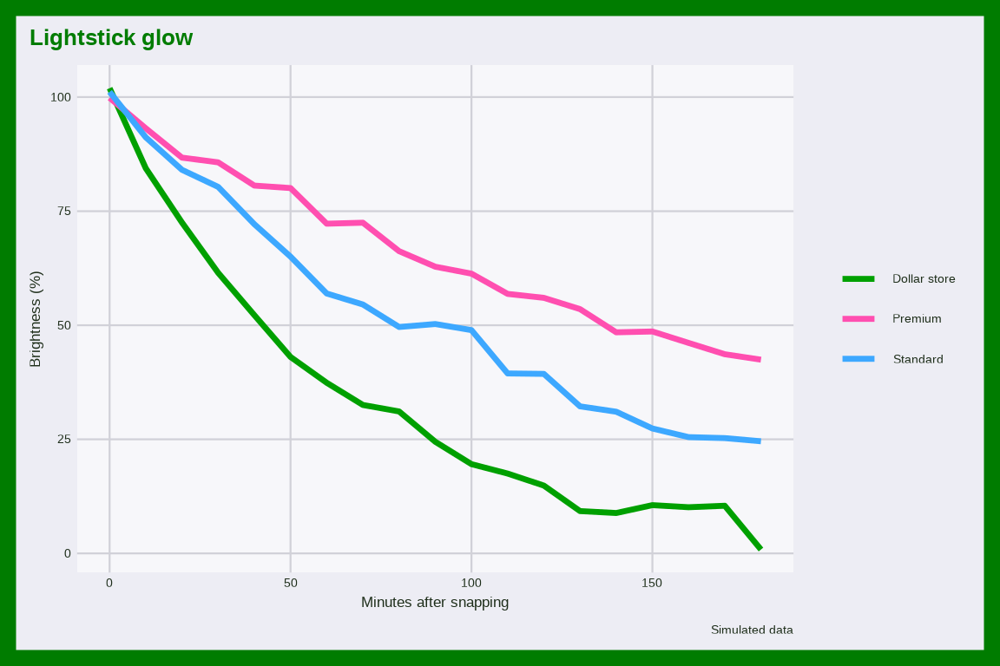

## Liminal space

[`theme_liminal()`](https://mjfrigaard.github.io/fmggp2/reference/theme_liminal.md):
Liminal space is an internet aesthetic of empty in between places:
hallways, waiting rooms, and closed malls (see [Liminal
space](https://en.wikipedia.org/wiki/Liminal_space) on Wikipedia). The
palette follows the article’s empty hallways, pool rooms, and Twin Peaks
Black Lodge: red curtains, black floor, mustard walls, fluorescent
green, pool blue, and concrete. The image shows an empty carpeted
hallway in the Stanley Hotel.


Image: Larry D. Moore, [Wikimedia
Commons](https://commons.wikimedia.org/wiki/File:Corridor_Stanley_Hotel_Estes_Park_Colorado_2024.jpg),
CC BY 4.0.

``` r

set.seed(2019)
halls <- data.frame(place = rep(c("Hotel hallway", "Empty mall", "Parking garage", "Pool room"), each = 100))
halls$eeriness <- pmin(10, pmax(0, rnorm(400, mean = c("Hotel hallway" = 7, "Empty mall" = 6, "Parking garage" = 5, "Pool room" = 8)[halls$place], sd = 1.5)))
ggplot(halls, aes(x = eeriness, y = place, fill = place)) +
  geom_violin(show.legend = FALSE) +
  labs(title = "How eerie is it?", caption = "Simulated data", x = "Eeriness (0 to 10)", y = NULL) +
  theme_liminal(base_size = 13)
```


## Livestream

[`theme_livestream()`](https://mjfrigaard.github.io/fmggp2/reference/theme_livestream.md):
Livestreaming is broadcasting video in real time, from gaming streams to
vlogs filmed on the street (see [Live
streaming](https://en.wikipedia.org/wiki/Live_streaming) on Wikipedia).
The palette follows a live broadcast as the article describes it: the
red live badge, stream purple, chat green, viewer blue, and donation
gold on a dark player. The image shows a journalist livestreaming from a
railway station.


Image: N509FZ, [Wikimedia
Commons](https://commons.wikimedia.org/wiki/File:CR_staff_and_PeopleRail_journalist_livestreaming_at_Beijing_Fengtai_Railway_Station_Exit_5_(20220620132147).jpg),
CC BY-SA 4.0.

``` r

set.seed(2011)
streams <- data.frame(category = rep(c("Gaming", "Just chatting", "Music", "IRL"), each = 150))
streams$viewers <- rlnorm(600, meanlog = c(Gaming = 5, "Just chatting" = 4.5, Music = 3.8, IRL = 4)[streams$category], sdlog = 1)
ggplot(streams, aes(x = viewers, fill = category)) +
  geom_histogram(bins = 30) +
  scale_x_log10() +
  labs(title = "Live viewers", caption = "Simulated data", x = "Viewers (log scale)", fill = NULL) +
  theme_livestream(base_size = 13)
```


With `mode = "light"`:

``` r

last_plot() + theme_livestream(base_size = 13, mode = "light")
```


## Matcha

[`theme_matcha()`](https://mjfrigaard.github.io/fmggp2/reference/theme_matcha.md):
Matcha is finely ground Japanese green tea, now a cafe staple as a latte
(see [Matcha](https://en.wikipedia.org/wiki/Matcha) on Wikipedia). The
palette follows the article’s vivid green color, matcha lattes, soba
noodles, and wagashi: ceremonial green, bright green, latte foam,
buckwheat, red bean, and tea leaf. The image shows a bamboo scoop of
matcha powder.


Image: Evanhoever, [Wikimedia
Commons](https://commons.wikimedia.org/wiki/File:Matcha_Scoop.jpg), CC
BY-SA 4.0.

``` r

set.seed(2021)
cafe <- data.frame(month = rep(1:12, 3), drink = rep(c("Matcha latte", "Iced matcha", "Matcha lemonade"), each = 12))
cafe$cups <- round(c("Matcha latte" = 120, "Iced matcha" = 80, "Matcha lemonade" = 30)[cafe$drink] +
  ifelse(cafe$drink == "Matcha latte", -1, 1) * 25 * sin((cafe$month - 4) / 12 * 2 * pi) + rnorm(36, 0, 6))
ggplot(cafe, aes(x = month, y = cups, colour = drink)) +
  geom_line(linewidth = 1) +
  scale_x_continuous(breaks = 1:12, labels = substr(month.abb, 1, 1)) +
  labs(title = "Matcha sales", caption = "Simulated data", x = NULL, y = "Cups sold", colour = NULL) +
  theme_matcha(base_size = 13)
```


## Mermaidcore

[`theme_mermaidcore()`](https://mjfrigaard.github.io/fmggp2/reference/theme_mermaidcore.md):
Mermaidcore is a fashion trend of shells, pearls, sequins, and
iridescent sea colors (see
[Mermaid](https://en.wikipedia.org/wiki/Mermaid) on Wikipedia). The
palette follows the Mermaid article’s pale green hair, scales, and sea,
with the nacre shell’s iridescence: seafoam, teal, lilac, coral, deep
sea, and pearl gold. The image shows a cutaway nautilus shell showing
its pearly chambers (Wikipedia’s Nacre article).


Image: Chris 73, [Wikimedia
Commons](https://commons.wikimedia.org/wiki/File:NautilusCutawayLogarithmicSpiral.jpg),
CC BY-SA 3.0.

``` r

set.seed(1837)
shells <- data.frame(width = rlnorm(300, log(6), 0.35))
shells$chambers <- round(8 + 3 * shells$width + rnorm(300, 0, 3))
shells$beach <- sample(c("North cove", "South cove"), 300, replace = TRUE)
ggplot(shells, aes(x = width, y = chambers, colour = beach)) +
  geom_point(alpha = 0.7) +
  labs(title = "Shell collection", caption = "Simulated data", x = "Width (cm)", y = "Chambers", colour = NULL) +
  theme_mermaidcore(base_size = 13)
```


## Mushroom lamp

[`theme_mushroomlamp()`](https://mjfrigaard.github.io/fmggp2/reference/theme_mushroomlamp.md):
Mushroom lamps are glowing nightlights that became a bedroom decor trend
(see [Nightlight](https://en.wikipedia.org/wiki/Nightlight) on
Wikipedia). The palette follows the article’s nightlight sources
(incandescent amber, neon orange, and soft electroluminescent green and
blue) plus a red spotted mushroom cap. The image shows a green LED
nightlight plugged into a wall.

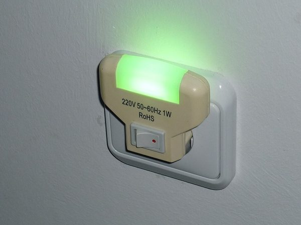

Image: Tetris L, [Wikimedia
Commons](https://commons.wikimedia.org/wiki/File:LED_nightlight_with_switch.JPG),
CC BY-SA 3.0.

``` r

set.seed(2020)
lamps <- data.frame(hour = rep(seq(18, 30, by = 0.5), 2), room = rep(c("Bedroom", "Dorm"), each = 25))
lamps$lumens <- pmax(0, 40 * dnorm(lamps$hour, mean = ifelse(lamps$room == "Bedroom", 23, 25), sd = 2.5) * 6 + rnorm(50, 0, 1))
ggplot(lamps, aes(x = hour, y = lumens, fill = room)) +
  geom_area(alpha = 0.7, position = "identity") +
  scale_x_continuous(breaks = seq(18, 30, 3), labels = c("6pm", "9pm", "12am", "3am", "6am")) +
  labs(title = "Nightlight glow", caption = "Simulated data", x = NULL, y = "Lumens", fill = NULL) +
  theme_mushroomlamp(base_size = 13)
```

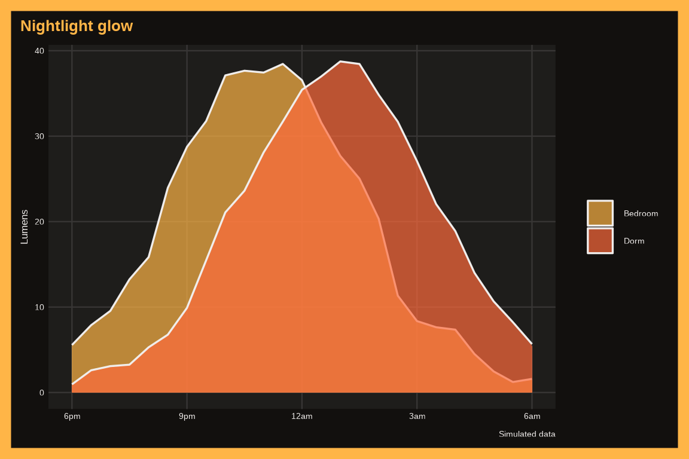

With `mode = "light"`:

``` r

last_plot() + theme_mushroomlamp(base_size = 13, mode = "light")
```

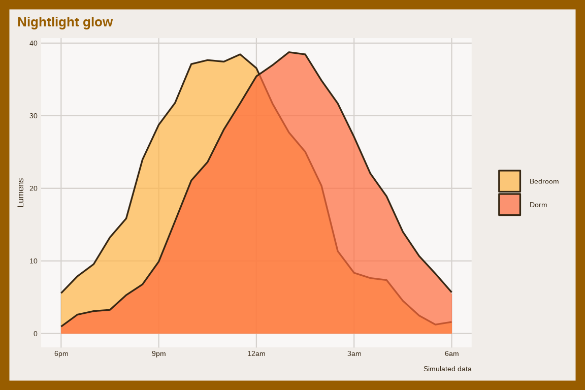

## Photo dump

[`theme_photodump()`](https://mjfrigaard.github.io/fmggp2/reference/theme_photodump.md):
A photo dump is a carousel post of loosely related phone photos from the
week (see [Camera phone](https://en.wikipedia.org/wiki/Camera_phone) on
Wikipedia). The palette follows the article’s camera phone shots in
bright and low light: golden hour, sunset coral, sky, night, park green,
and lilac dusk. The image shows a phone on a tripod recording a sunset
over water.


Image: PantheraLeo1359531, [Wikimedia
Commons](https://commons.wikimedia.org/wiki/File:Handyaufnahme_des_Sonnenuntergangs_als_Zeitraffer_20200909_DSC3277.jpg),
CC BY 4.0.

``` r

set.seed(2021)
dump <- data.frame(slides = sample(2:10, 400, replace = TRUE))
dump$likes <- round(rlnorm(400, meanlog = 4 + 0.08 * dump$slides, sdlog = 0.6))
dump$posted <- sample(c("Weekday", "Weekend"), 400, replace = TRUE)
ggplot(dump, aes(x = factor(slides), y = likes, fill = posted)) +
  geom_boxplot() +
  labs(title = "Photo dump likes", caption = "Simulated data", x = "Photos in the carousel", y = "Likes", fill = NULL) +
  theme_photodump(base_size = 13)
```


## Pickleball

[`theme_pickleball()`](https://mjfrigaard.github.io/fmggp2/reference/theme_pickleball.md):
Pickleball is a paddle sport played with a plastic ball over a low net,
and the fastest growing sport in the US (see
[Pickleball](https://en.wikipedia.org/wiki/Pickleball) on Wikipedia).
The palette follows the article’s plastic ball, paddles, net, and court:
optic yellow, court blue and green, red paddle, black net, and an orange
ball. The image shows a professional doubles match on a pickleball
court.

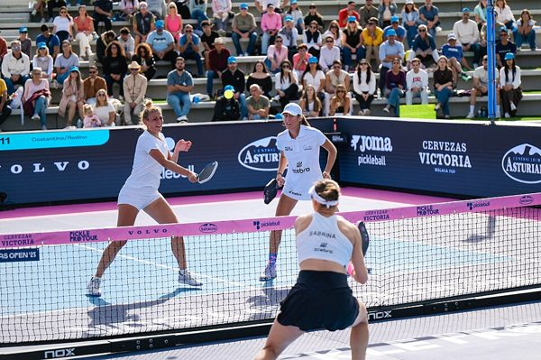

Image: CarVeFe, [Wikimedia
Commons](https://commons.wikimedia.org/wiki/File:Pickle_Pro_Tour_2025_2.jpg),
CC0.

``` r

set.seed(1965)
rallies <- data.frame(level = rep(c("Beginner", "Club", "Pro"), each = 200))
rallies$shots <- rnbinom(600, size = 4, mu = c(Beginner = 5, Club = 9, Pro = 14)[rallies$level])
ggplot(rallies, aes(x = shots, fill = level)) +
  geom_bar(position = "dodge") +
  labs(title = "Rally lengths", caption = "Simulated data", x = "Shots per rally", y = "Rallies", fill = NULL) +
  theme_pickleball(base_size = 13)
```

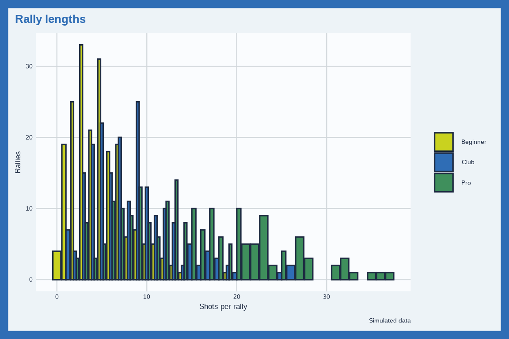

## Plushie

[`theme_plushie()`](https://mjfrigaard.github.io/fmggp2/reference/theme_plushie.md):
Plushies (stuffed toys) are collected, displayed, and carried well past
childhood (see [Stuffed toy](https://en.wikipedia.org/wiki/Stuffed_toy)
on Wikipedia). The palette follows the article’s soft toys in “a wide
variety of colors” and fur textures: teddy honey, bunny pink, frog
green, sky blue, lavender, and button eye brown. The image shows a
replica of an early Steiff teddy bear.


Image: MatthiasKabel, [Wikimedia
Commons](https://commons.wikimedia.org/wiki/File:Nachbildung_55PB_Steiff_Museum_Giengen.jpg),
CC BY-SA 3.0.

``` r

set.seed(1902)
plush <- data.frame(animal = rep(c("Bear", "Frog", "Cat", "Shark"), each = 90))
plush$squish <- rbeta(360, shape1 = c(Bear = 6, Frog = 4, Cat = 5, Shark = 3)[plush$animal], shape2 = 3) * 10
ggplot(plush, aes(x = squish, fill = animal)) +
  geom_density(alpha = 0.6) +
  labs(title = "Squish ratings", caption = "Simulated data", x = "Squishiness (0 to 10)", fill = NULL) +
  theme_plushie(base_size = 13)
```


## RGB setup

[`theme_rgbsetup()`](https://mjfrigaard.github.io/fmggp2/reference/theme_rgbsetup.md):
An RGB setup is a gaming PC and desk lit up in color changing lights
(see [Gaming computer](https://en.wikipedia.org/wiki/Gaming_computer) on
Wikipedia). The palette follows the article’s gaming PCs lit in RGB:
cyan, purple, red, lime, and blue case lighting with a white glow. The
image shows a gaming PC with glass panels and colored fans.

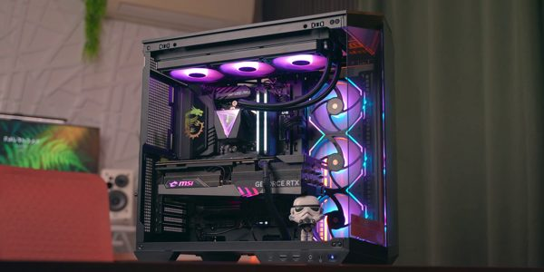

Image: MoreThanTech, [Wikimedia
Commons](https://commons.wikimedia.org/wiki/File:MSI-Gaming-PC_2024-09-30.png),
CC BY 3.0.

``` r

set.seed(2024)
fps <- data.frame(game = rep(c("Shooter", "Racing", "Open world", "Sandbox"), each = 120))
fps$fps <- rnorm(480, mean = c(Shooter = 165, Racing = 120, "Open world" = 75, Sandbox = 140)[fps$game], sd = 15)
ggplot(fps, aes(x = fps, y = game, fill = game)) +
  geom_boxplot(show.legend = FALSE) +
  labs(title = "Frames per second", caption = "Simulated data", x = "FPS", y = NULL) +
  theme_rgbsetup(base_size = 13)
```

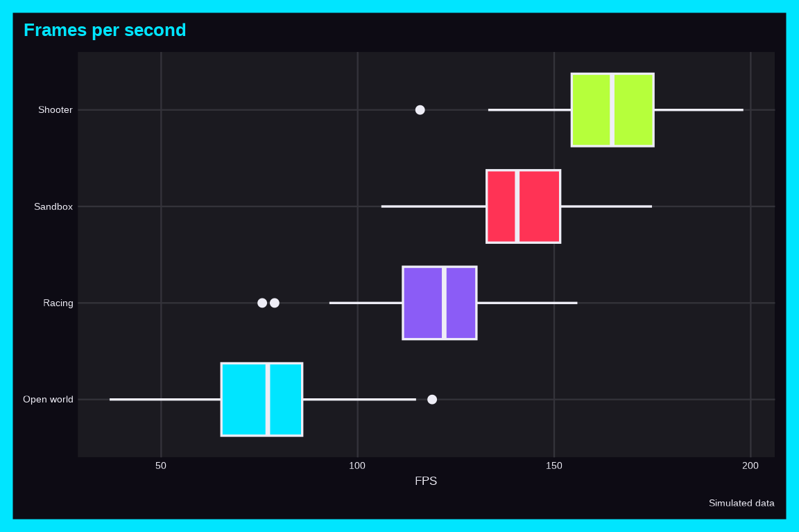

With `mode = "light"`:

``` r

last_plot() + theme_rgbsetup(base_size = 13, mode = "light")
```

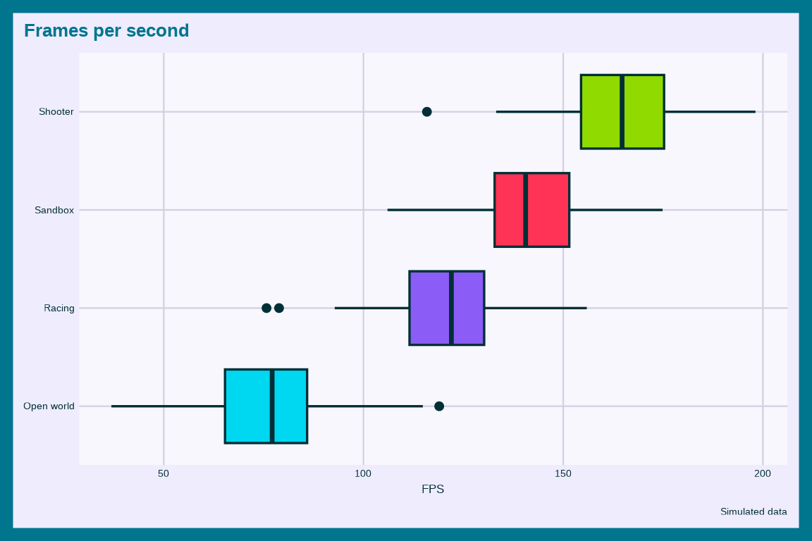

## Ring light

[`theme_ringlight()`](https://mjfrigaard.github.io/fmggp2/reference/theme_ringlight.md):
Ring lights are the circular lights behind nearly every vlog, makeup
tutorial, and video call (see [Ring
flash](https://en.wikipedia.org/wiki/Ring_flash) on Wikipedia). The
palette follows the article’s adjustable color temperature (warm 3200K
and cool 5600K), skin tones on video calls, and the gray and black ring
and stand. The image shows a ring of LEDs next to its controller.

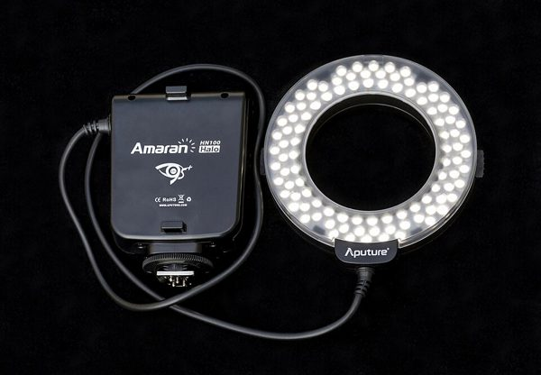

Image: Jacek Halicki, [Wikimedia
Commons](https://commons.wikimedia.org/wiki/File:2015_Lampa_b%C5%82yskowa_pier%C5%9Bcieniowa_Aputure.jpg),
CC BY-SA 4.0.

``` r

set.seed(2015)
ring <- data.frame(brightness = runif(300, 10, 100))
ring$views <- round(exp(6 + 0.02 * ring$brightness + rnorm(300, 0, 0.5)))
ring$video <- sample(c("Makeup", "Vlog", "Unboxing"), 300, replace = TRUE)
ggplot(ring, aes(x = brightness, y = views, colour = video)) +
  geom_point(alpha = 0.7) +
  scale_y_log10() +
  labs(title = "Ring light brightness", caption = "Simulated data", x = "Brightness (%)", y = "Views (log scale)", colour = NULL) +
  theme_ringlight(base_size = 13)
```

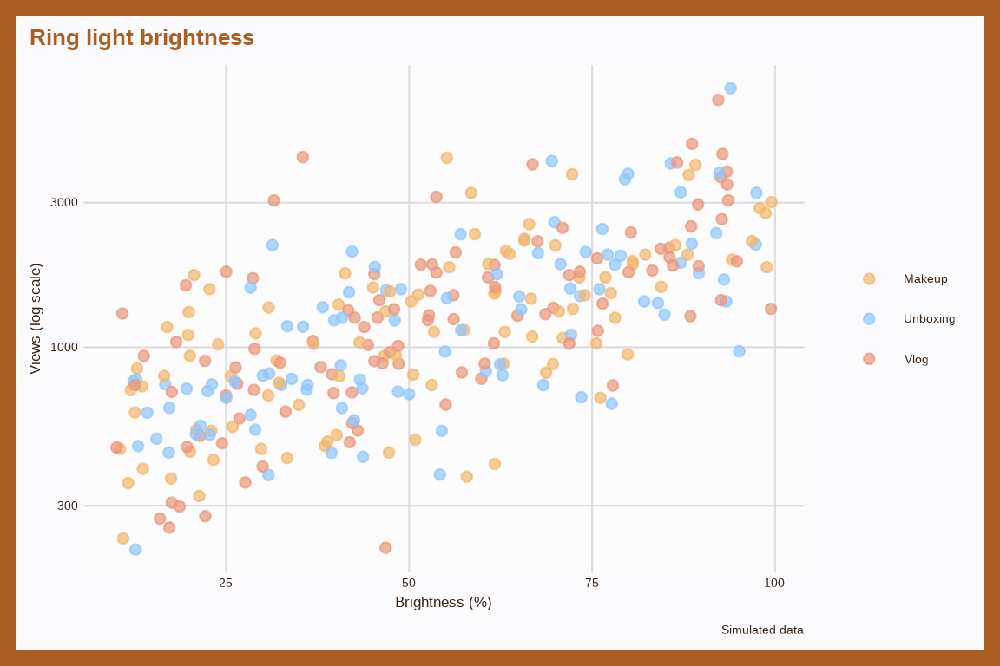

## Slime

[`theme_slime()`](https://mjfrigaard.github.io/fmggp2/reference/theme_slime.md):
Slime is the stretchy toy that kids make at home and watch in satisfying
videos (see [Slime (toy)](https://en.wikipedia.org/wiki/Slime_(toy)) on
Wikipedia). The palette follows the article’s oozy green slime, the
other colors from food coloring, and its plastic trash can. The image
shows green slime poured from a cup.


Image: Ciphers, [Wikimedia
Commons](https://commons.wikimedia.org/wiki/File:Pouring_Slime.JPG), CC
BY-SA 3.0.

``` r

set.seed(1976)
slime <- data.frame(recipe = rep(c("Glue and borax", "Contact solution", "Cornstarch"), each = 150))
slime$stretch <- rgamma(450, shape = c("Glue and borax" = 9, "Contact solution" = 6, Cornstarch = 3)[slime$recipe], rate = 0.3)
ggplot(slime, aes(x = stretch, fill = recipe)) +
  geom_histogram(bins = 30, alpha = 0.8, position = "identity") +
  labs(title = "Slime stretch test", caption = "Simulated data", x = "Stretch (cm)", fill = NULL) +
  theme_slime(base_size = 13)
```


## Speedrun

[`theme_speedrun()`](https://mjfrigaard.github.io/fmggp2/reference/theme_speedrun.md):
Speedrunning is beating a video game as fast as possible, often live for
charity (see [Speedrunning](https://en.wikipedia.org/wiki/Speedrunning)
on Wikipedia). The palette follows the article’s timers and
leaderboards: split timer gold (best segment), green (ahead), red
(behind), white digits, and tool assisted cyan and purple. The image
shows the crowd at a Summer Games Done Quick charity marathon.

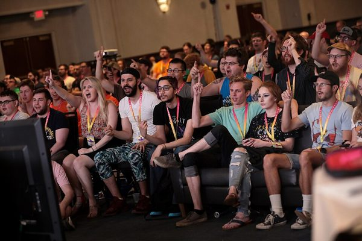

Image: Gage Skidmore from Peoria, AZ, United States of America,
[Wikimedia
Commons](https://commons.wikimedia.org/wiki/File:Summer_Games_Done_Quick_attendees_(48149404692).jpg),
CC BY-SA 2.0.

``` r

set.seed(2014)
runs <- data.frame(attempt = 1:200)
runs$minutes <- 60 * exp(-runs$attempt / 80) + 25 + rnorm(200, 0, 2)
runs$category <- ifelse(runs$attempt %% 2 == 0, "Any%", "100%")
runs$minutes <- runs$minutes + ifelse(runs$category == "100%", 30, 0)
ggplot(runs, aes(x = attempt, y = minutes, colour = category)) +
  geom_point(alpha = 0.6) +
  geom_smooth(se = FALSE, method = "loess", formula = y ~ x) +
  labs(title = "Personal bests", caption = "Simulated data", x = "Attempt", y = "Minutes", colour = NULL) +
  theme_speedrun(base_size = 13)
```

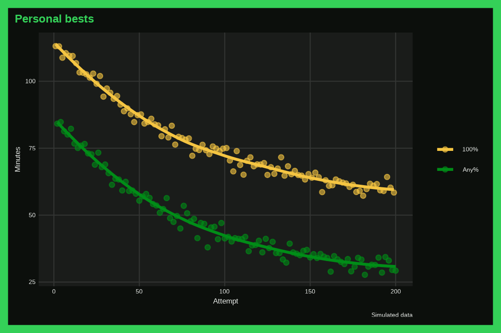

With `mode = "light"`:

``` r

last_plot() + theme_speedrun(base_size = 13, mode = "light")
```

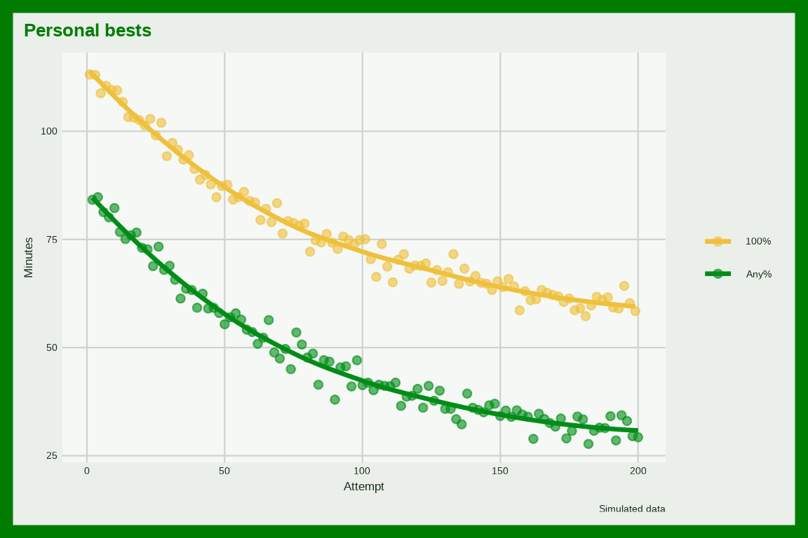

## Streak

[`theme_streak()`](https://mjfrigaard.github.io/fmggp2/reference/theme_streak.md):
Streaks are the daily counters that apps use to keep you coming back, a
common gamification trick (see
[Gamification](https://en.wikipedia.org/wiki/Gamification) on
Wikipedia). The palette follows the article’s points, badges, levels,
and progress bars: streak flame orange and red, gold badge, XP purple,
progress green, and a frozen streak blue. The image shows a poster of
the five steps to earn a digital badge.


Image: Nordplus project Open Badges for Adult Educators., [Wikimedia
Commons](https://commons.wikimedia.org/wiki/File:AdEO_Adult_Educator_Online_-_Five_steps_to_get_a_badge.png),
CC BY-SA 4.0.

``` r

set.seed(2012)
streaks <- data.frame(app = rep(c("Language", "Fitness", "Messaging"), each = 250))
streaks$days <- rgeom(750, prob = c(Language = 1 / 40, Fitness = 1 / 15, Messaging = 1 / 90)[streaks$app])
ggplot(streaks, aes(x = days, colour = app)) +
  stat_ecdf(linewidth = 1) +
  labs(title = "How long streaks last", caption = "Simulated data", x = "Streak length (days)", y = "Share of streaks", colour = NULL) +
  theme_streak(base_size = 13)
```

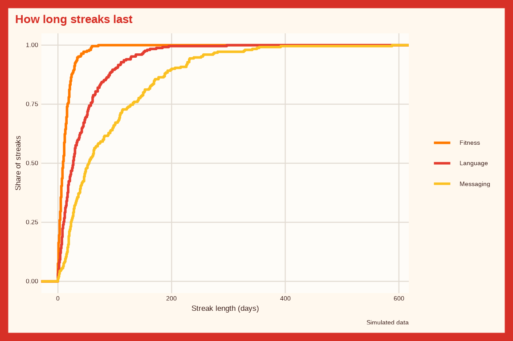

## Synthwave

[`theme_synthwave()`](https://mjfrigaard.github.io/fmggp2/reference/theme_synthwave.md):
Synthwave is electronic music (and art) that looks back at 1980s film
scores: neon grids and chrome sunsets (see
[Synthwave](https://en.wikipedia.org/wiki/Synthwave) on Wikipedia). The
palette follows the article’s outrun look: magenta neon, gridlines, and
a 1980s sunset in pink, orange, and yellow, with violet and chrome blue.
The image shows a neon grid under a striped sunset.

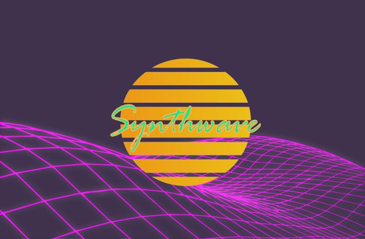

Image: j4p4n, [Wikimedia
Commons](https://commons.wikimedia.org/wiki/File:Synthwave.svg), CC0.

``` r

set.seed(1984)
tracks <- data.frame(bpm = rnorm(300, 110, 12))
tracks$plays <- round(rlnorm(300, meanlog = 8 + 0.01 * (tracks$bpm - 110), sdlog = 0.7))
tracks$mood <- sample(c("Night drive", "Neon", "Retro"), 300, replace = TRUE)
ggplot(tracks, aes(x = bpm, y = plays, colour = mood)) +
  geom_point(alpha = 0.8) +
  scale_y_log10() +
  labs(title = "Synthwave tracks", caption = "Simulated data", x = "BPM", y = "Plays (log scale)", colour = NULL) +
  theme_synthwave(base_size = 13)
```

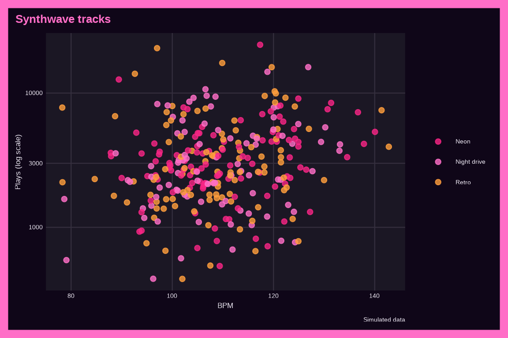

With `mode = "light"`:

``` r

last_plot() + theme_synthwave(base_size = 13, mode = "light")
```

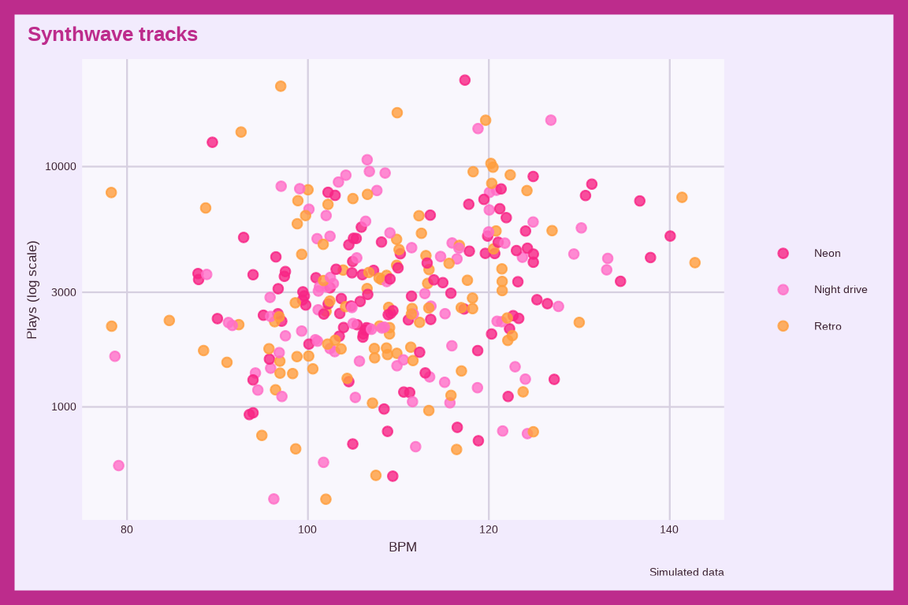

## Thrift

[`theme_thrift()`](https://mjfrigaard.github.io/fmggp2/reference/theme_thrift.md):
Thrifting (shopping at charity and secondhand shops) is the budget and
planet friendly way to build a wardrobe (see [Charity
shop](https://en.wikipedia.org/wiki/Charity_shop) on Wikipedia). The
palette follows the article’s Red Cross and Oxfam shops and vintage
clothing: charity red, mustard, faded denim, corduroy brown, Oxfam
green, and dusty rose. The image shows shelves of glassware and goodies
in a thrift store.


Image: Valerie Everett, [Wikimedia
Commons](https://commons.wikimedia.org/wiki/File:Thrift_store_goodies.jpg),
CC BY-SA 2.0.

``` r

set.seed(1999)
haul <- data.frame(category = rep(c("Jeans", "Jackets", "Mugs", "Vinyl", "Lamps"), each = 60))
haul$price <- rlnorm(300, meanlog = log(c(Jeans = 12, Jackets = 20, Mugs = 2, Vinyl = 5, Lamps = 15)[haul$category]), sdlog = 0.4)
ggplot(haul, aes(x = category, y = price, colour = category)) +
  geom_jitter(width = 0.25, alpha = 0.7, show.legend = FALSE) +
  labs(title = "Thrift haul prices", caption = "Simulated data", x = NULL, y = "Price ($)") +
  theme_thrift(base_size = 13)
```


## Tumbler

[`theme_tumbler()`](https://mjfrigaard.github.io/fmggp2/reference/theme_tumbler.md):
Insulated tumblers and water bottles (vacuum flasks) became a status
accessory in the 2020s (see [Vacuum
flask](https://en.wikipedia.org/wiki/Vacuum_flask) on Wikipedia). The
palette follows the article’s stainless vacuum flask, in the powder
coated colors of today’s tumblers (cream, sage, rose, and cobalt) and
the classic red Thermos. The image shows a red vacuum flask on a
cafeteria table.


Image: Denae Bedard, [Wikimedia
Commons](https://commons.wikimedia.org/wiki/File:Thermos.JPG), CC BY-SA
3.0.

``` r

set.seed(1892)
flasks <- data.frame(hour = rep(0:12, 3), bottle = rep(c("Vacuum flask", "Plastic bottle", "Glass"), each = 13))
flasks$temp <- 4 + (90 - 4) * exp(-flasks$hour / c("Vacuum flask" = 30, "Plastic bottle" = 3, Glass = 2)[flasks$bottle])
ggplot(flasks, aes(x = hour, y = temp, colour = bottle)) +
  geom_line(linewidth = 1) +
  geom_point() +
  labs(title = "Still hot?", caption = "Simulated data", x = "Hours", y = "Temperature (C)", colour = NULL) +
  theme_tumbler(base_size = 13)
```


## Unboxing

[`theme_unboxing()`](https://mjfrigaard.github.io/fmggp2/reference/theme_unboxing.md):
Unboxing videos film someone opening a new product, from phones to
sneakers (see [Unboxing](https://en.wikipedia.org/wiki/Unboxing) on
Wikipedia). The palette follows the article’s boxes as “marketing
billboards”: kraft cardboard, packing tape, black print, tissue paper
pink, brand blue, and a sticker green. The image shows hands lifting a
new instrument out of its shipping box.


Image: Audiotecna, [Wikimedia
Commons](https://commons.wikimedia.org/wiki/File:Moog_Etherwave_Theremin_unboxing_-_2._contents_of_the_box_(by_Audiotecna).jpg),
CC BY 2.0.

``` r

set.seed(2006)
unbox <- data.frame(product = rep(c("Phone", "Sneakers", "Console", "Makeup"), each = 100))
unbox$minutes <- rgamma(400, shape = c(Phone = 8, Sneakers = 4, Console = 10, Makeup = 6)[unbox$product], rate = 0.8)
ggplot(unbox, aes(x = minutes, y = product, fill = product)) +
  geom_violin(show.legend = FALSE) +
  labs(title = "Unboxing video length", caption = "Simulated data", x = "Minutes", y = NULL) +
  theme_unboxing(base_size = 13)
```


## Vaporwave

[`theme_vaporwave()`](https://mjfrigaard.github.io/fmggp2/reference/theme_vaporwave.md):
Vaporwave is a 2010s music genre and meme aesthetic of slowed down mall
music, old computers, and pink and teal gradients (see
[Vaporwave](https://en.wikipedia.org/wiki/Vaporwave) on Wikipedia). The
palette follows the 1980s and 1990s anime and mall imagery the article
cites, as the classic vaporwave pastels: pink, cyan, mint, purple, pale
yellow, and deep violet. The image shows a vaporwave style Wikipedia
logo with windows and planets.


Image: AtikaAtikawa, [Wikimedia
Commons](https://commons.wikimedia.org/wiki/File:Wikiwave_00000.png), CC
BY-SA 4.0.

``` r

set.seed(2011)
vapor <- data.frame(year = rep(2010:2020, 2), source = rep(c("Smooth jazz", "Mall music"), each = 11))
vapor$samples <- round(c("Smooth jazz" = 20, "Mall music" = 12)[vapor$source] * dnorm(vapor$year, 2014, 2.5) * 6 + rnorm(22, 0, 0.5), 1)
ggplot(vapor, aes(x = year, y = samples, fill = source)) +
  geom_col(position = "dodge") +
  scale_x_continuous(breaks = seq(2010, 2020, by = 2)) +
  labs(title = "Vaporwave samples", caption = "Simulated data", x = NULL, y = "Albums (hundreds)", fill = NULL) +
  theme_vaporwave(base_size = 13)
```


## Vinyl

[`theme_vinyl()`](https://mjfrigaard.github.io/fmggp2/reference/theme_vinyl.md):
Vinyl records outsell CDs again, thanks to collectors who buy albums in
colored variants (see [Phonograph
record](https://en.wikipedia.org/wiki/Phonograph_record) on Wikipedia).
The palette follows the article’s “black disc”, Red Seal labels,
transparent red vinylite, the Blue Goose label, gold label foil, and
paper sleeves. The image shows LP, EP, and single records side by side.


Image: Banfield, [Wikimedia
Commons](https://commons.wikimedia.org/wiki/File:Vinilos_distintos_tama%C3%B1os.jpg),
CC BY-SA 3.0.

``` r

set.seed(1948)
records <- data.frame(year = rep(2010:2024, 2), format = rep(c("Vinyl", "CD"), each = 15))
records$sales <- ifelse(records$format == "Vinyl", 3 * exp((records$year - 2010) * 0.18), 100 * exp(-(records$year - 2010) * 0.17)) + rnorm(30, 0, 1)
ggplot(records, aes(x = year, y = sales, colour = format)) +
  geom_line(linewidth = 1.2) +
  labs(title = "Vinyl's comeback", caption = "Simulated data", x = NULL, y = "Albums sold (millions)", colour = NULL) +
  theme_vinyl(base_size = 13)
```


## Voice note

[`theme_voicenote()`](https://mjfrigaard.github.io/fmggp2/reference/theme_voicenote.md):
Voice notes are short recorded messages sent in a chat instead of typing
(see [Voicemail](https://en.wikipedia.org/wiki/Voicemail) on Wikipedia).
The palette follows the article’s pink message slips and voicemail
light, with record red, mic gray, call green, waveform violet, and
amber. The image shows a diagram of how a voicemail system routes and
stores messages.


Image: Robert Cohn (Rsc at en.wikipedia), [Wikimedia
Commons](https://commons.wikimedia.org/wiki/File:System_poczty_glosowej.jpg),
CC BY 2.5.

``` r

set.seed(1979)
notes <- data.frame(sender = rep(c("Best friend", "Mom", "Group chat"), each = 200))
notes$seconds <- rlnorm(600, meanlog = log(c("Best friend" = 45, Mom = 90, "Group chat" = 20)[notes$sender]), sdlog = 0.6)
ggplot(notes, aes(x = seconds, fill = sender)) +
  geom_histogram(bins = 30) +
  scale_x_log10() +
  labs(title = "Voice note length", caption = "Simulated data", x = "Seconds (log scale)", fill = NULL) +
  theme_voicenote(base_size = 13)
```


## Weirdcore

[`theme_weirdcore()`](https://mjfrigaard.github.io/fmggp2/reference/theme_weirdcore.md):
Weirdcore is an internet aesthetic of low quality images, liminal
spaces, and unsettling captions (see
[Weirdcore](https://en.wikipedia.org/wiki/Weirdcore) on Wikipedia). The
palette follows the article’s out of place red text and black rectangle
voids, over low quality photos of sky, grass, and sepia nostalgia. The
image shows a grassy grid under a black sun with the caption “You must
escape this simulation”.


Image: YDK1122, [Wikimedia
Commons](https://commons.wikimedia.org/wiki/File:Weirdcore_862761.jpg),
CC BY-SA 3.0.

``` r

set.seed(2021)
weird <- data.frame(x = rnorm(300), y = rnorm(300))
weird$feeling <- cut(sqrt(weird$x^2 + weird$y^2), c(0, 0.8, 1.6, Inf), labels = c("Familiar", "Uneasy", "Wrong"))
ggplot(weird, aes(x = x, y = y, colour = feeling)) +
  geom_point(size = 2, alpha = 0.8) +
  coord_equal() +
  labs(title = "Have you been here before?", caption = "Simulated data", x = NULL, y = NULL, colour = NULL) +
  theme_weirdcore(base_size = 13)
```


## Wired earbuds

[`theme_wiredbuds()`](https://mjfrigaard.github.io/fmggp2/reference/theme_wiredbuds.md):
Wired earbuds made a comeback as a style statement and a break from
charging (see [Headphones](https://en.wikipedia.org/wiki/Headphones) on
Wikipedia). The palette follows the Headphones article’s rubber, gold
contacts, and wire, plus the red right channel marker, the wood table,
and navy. The image shows a pair of white wired earbuds on a wooden
table.


Image: Jerikasb, [Wikimedia
Commons](https://commons.wikimedia.org/wiki/File:Earbud_wires.jpg), CC
BY-SA 4.0.

``` r

set.seed(2001)
buds <- data.frame(type = rep(c("Wired", "Wireless"), each = 200))
buds$hours <- ifelse(buds$type == "Wired", rnorm(200, 3, 1), rnorm(200, 2.5, 0.8))
buds$tangles <- ifelse(buds$type == "Wired", rpois(200, 3), 0)
ggplot(buds, aes(x = hours, fill = type)) +
  geom_density(alpha = 2/3) +
  labs(title = "Daily listening", caption = "Simulated data", x = "Hours per day", fill = NULL) +
  theme_wiredbuds(base_size = 13)
```


## Fonts

The themes use title fonts that ship with macOS and fall back to
`"sans"` when a font isn’t found: American Typewriter, Andale Mono,
Apple Chancery, Arial Black, Arial Narrow, Arial Rounded, Baskerville,
Big Caslon, Bradley Hand, Chalkboard, Chalkduster, Cochin, Comic Sans
MS, Copperplate, Courier New, Didot, DIN Alternate, DIN Condensed,
Futura, Gill Sans, Impact, Krungthep, Luminari, Marion, Marker Felt,
Noteworthy, Optima, Phosphate, PT Mono, Rockwell, SignPainter, Silom,
Skia, Snell Roundhand, Superclarendon, Tahoma, Times New Roman,
Trattatello, Trebuchet MS, and Verdana.
