# Themes

Each `ggzoomer` theme is named after an aesthetic, trend, or object from
Gen Z internet culture. Every palette follows how the topic looks to Gen
Z online: its colors, objects, and materials. Each section explains why
the topic is included, links its Wikipedia article (or the closest
article when the topic doesn’t have one), and shows a freely licensed
image from that article with simulated data to match.

Themes with a dark background also have a light version. Set
`mode = "light"` to get a light background with darker text and marks.
Dark is the default. Each dark theme’s section below shows both
versions.

``` r

library(ggzoomer)
library(ggplot2)
showtext::showtext_auto()
```

## Air fryer

[`theme_airfryer()`](https://mjfrigaard.github.io/ggzoomer/reference/theme_airfryer.md):
Air fryers are small countertop convection ovens that blow hot air
around food (see [Convection
oven](https://en.wikipedia.org/wiki/Convection_oven) on Wikipedia). Air
fryers went from a novelty to a common kitchen appliance in the 2020s.
Philips launched the first Airfryer in 2010, and by 2018 people used the
name for any brand. About 36% of US households had a convection oven in
2020. By 2023, an estimated 60% had one. In a 2024 UK study, one in five
people said the air fryer was the cooking device they used most.

The palette follows the colors the popular Crispi air fryer comes in:
Cherry Crush, Sage Green, Electric Cobalt, Butter Yellow, Cyberspace
navy, and Frosted Lilac on Stone. The image shows an air fryer basket of
reheated potatoes on a kitchen counter.

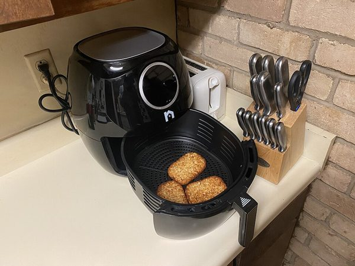

Image: I am R., [Wikimedia
Commons](https://commons.wikimedia.org/wiki/File:Air_Fryer_2020.jpg), CC
BY 2.0.

``` r

set.seed(2020)
fryer <- data.frame(food = rep(c("Fries", "Wings", "Nuggets", "Veggies"), each = 80))
fryer$minutes <- round(rnorm(320, mean = c(Fries = 15, Wings = 22, Nuggets = 10, Veggies = 12)[fryer$food], sd = 2.5), 1)
ggplot(fryer, aes(x = food, y = minutes, fill = food)) +
  geom_boxplot(show.legend = FALSE) +
  labs(title = "Air fryer cook times", caption = "Simulated data", x = NULL, y = "Minutes") +
  theme_airfryer(base_size = 13)
```

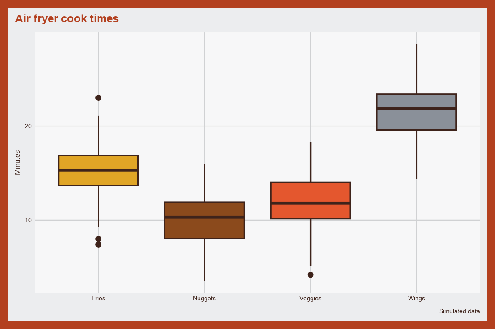

## ASMR

[`theme_asmr()`](https://mjfrigaard.github.io/ggzoomer/reference/theme_asmr.md):
ASMR (autonomous sensory meridian response) is the tingling some people
feel while watching whisper, tapping, and crinkle videos (see
[ASMR](https://en.wikipedia.org/wiki/ASMR) on Wikipedia). ASMR is the
calm, tingling feeling some people get from whispers, tapping, and other
quiet sounds. YouTube turned it into a genre. Many ASMR videos show one
person whispering or tapping straight into the camera. The Louvre
invited the channel PARIS ASMR to film there in 2019, and the first
major ASMR exhibition opened in Sweden in 2020. [Gibi
ASMR](https://en.wikipedia.org/wiki/Gibi_ASMR), one of YouTube’s top
ASMR creators, started her channel in 2016 and reached one million
subscribers about a year after college.

The palette follows the set behind [Gibi
ASMR](https://en.wikipedia.org/wiki/Gibi_ASMR)’s videos: a deep indigo
backdrop strung with blue and white fairy lights, a lilac top, red and
green bokeh, warm gold light, and pink nails. The image shows a body map
showing where ASMR tingles start and spread.

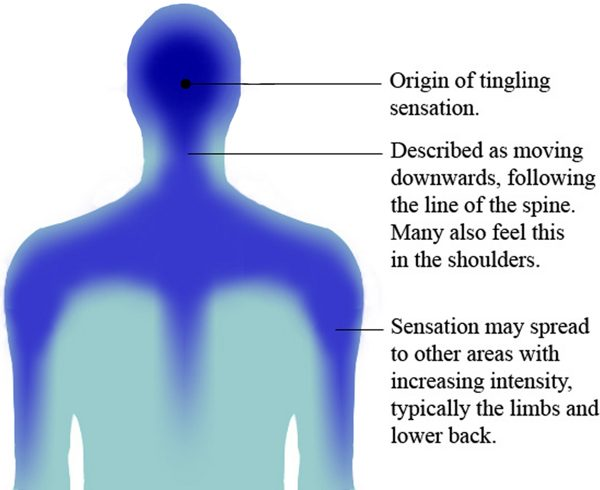

Image: Emma L. Barratt, Nick J. Davis, [Wikimedia
Commons](https://commons.wikimedia.org/wiki/File:ASMR_Map.png), CC BY
4.0.

``` r

set.seed(2010)
asmr <- data.frame(trigger = rep(c("Whispering", "Tapping", "Crinkling"), each = 200))
asmr$minutes <- rlnorm(600, meanlog = c(Whispering = 3, Tapping = 2.6, Crinkling = 2.3)[asmr$trigger], sdlog = 0.5)
ggplot(asmr, aes(x = minutes, fill = trigger)) +
  geom_density(alpha = 2/3) +
  labs(title = "ASMR watch time", caption = "Simulated data", x = "Minutes watched", fill = NULL) +
  theme_asmr(base_size = 13)
```

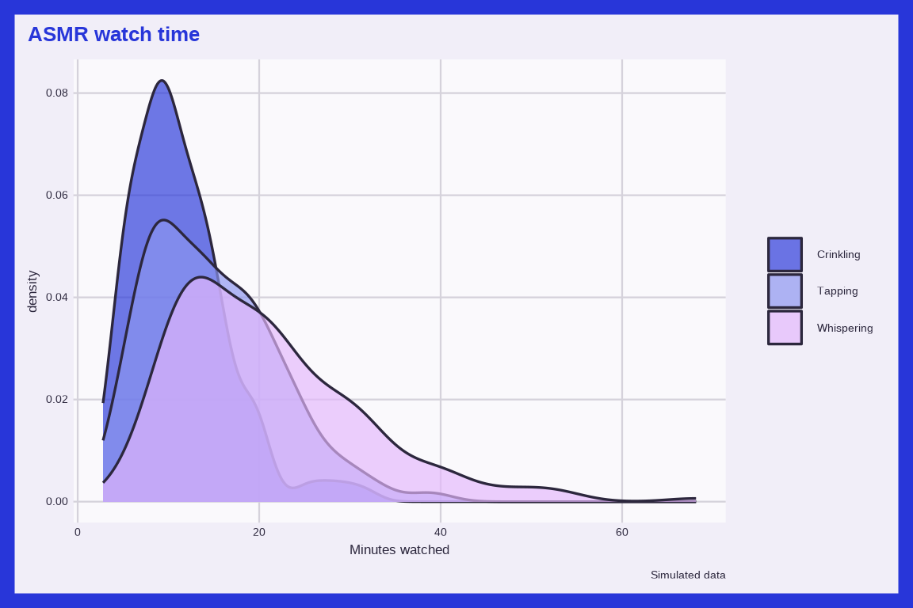

With `mode = "light"`:

``` r

last_plot() + theme_asmr(base_size = 13, mode = "light")
```

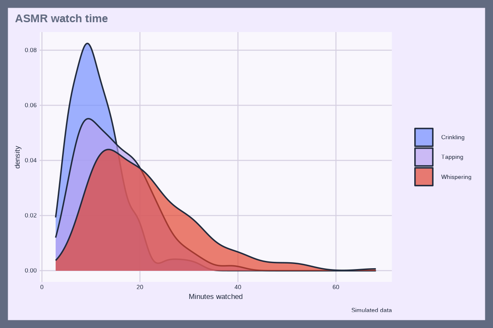

## Axolotl

[`theme_axolotl()`](https://mjfrigaard.github.io/ggzoomer/reference/theme_axolotl.md):
Axolotls are Mexican salamanders that keep their gills for life and
became an internet favorite (and a game mob) (see
[Axolotl](https://en.wikipedia.org/wiki/Axolotl) on Wikipedia). The
axolotl is a salamander that keeps its pink and white coloring, large
eyes, and feathery gills into adulthood. Online, it stands for cuteness,
aquatic pets, and staying young. Custom axolotl emojis often hold boba
tea or hearts, or wear tiny hats. In 2017, it became the official emoji
of Mexico City.

The palette follows the axolotl emoji: pink and white skin, deep pink
feathery gills, big black eyes, and the boba tea, hearts, and aquarium
water it often comes with. The image shows a wild type axolotl resting
on gravel in an aquarium.

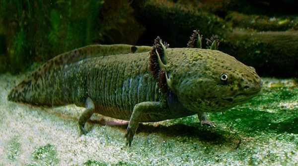

Image: LoKiLeCh, [Wikimedia
Commons](https://commons.wikimedia.org/wiki/File:Axolotl_ganz.jpg), CC
BY-SA 3.0.

``` r

set.seed(1864)
axolotls <- data.frame(morph = rep(c("Wild type", "Leucistic", "Golden albino"), each = 120))
axolotls$length <- rnorm(360, mean = c("Wild type" = 23, Leucistic = 21, "Golden albino" = 20)[axolotls$morph], sd = 3)
ggplot(axolotls, aes(x = morph, y = length, fill = morph)) +
  geom_violin(alpha = 2/3, show.legend = FALSE) +
  labs(title = "Axolotl lengths", caption = "Simulated data", x = NULL, y = "Length (cm)") +
  theme_axolotl(base_size = 13)
```

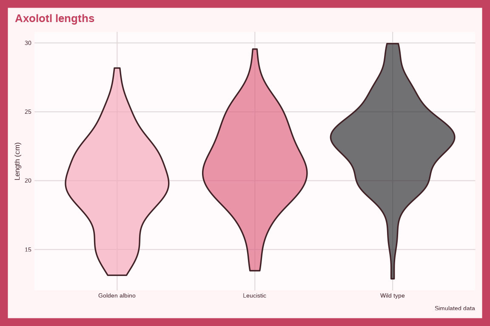

## Boba

[`theme_boba()`](https://mjfrigaard.github.io/ggzoomer/reference/theme_boba.md):
Bubble tea (boba) is a Taiwanese tea drink with chewy tapioca pearls
(see [Bubble tea](https://en.wikipedia.org/wiki/Bubble_tea) on
Wikipedia). Boba is known for its vibrant, layered colors, cups slick
with condensation, and swirling tapioca pearls or colorful popping boba.
That look makes it one of the most Instagrammable drinks around. For Gen
Z, a photo of a boba cup works as a kind of visual currency.

The palette follows the vibrant, layered drinks: black tapioca pearls,
milk tea, taro, strawberry, matcha, and mango popping boba. The image
shows a cup of milk tea with black tapioca pearls.

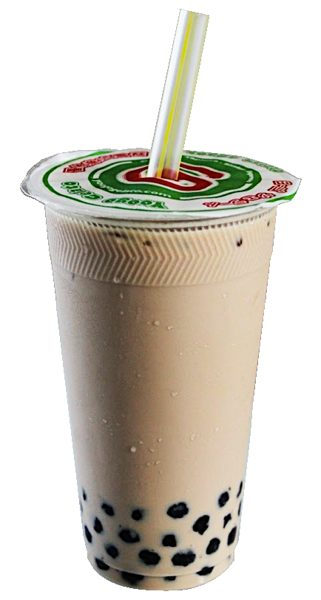

Image: Howief, [Wikimedia
Commons](https://commons.wikimedia.org/wiki/File:Bubble_Tea.png), CC
BY-SA 3.0.

``` r

set.seed(1980)
boba <- data.frame(flavor = sample(c("Classic milk", "Taro", "Brown sugar", "Matcha", "Mango"), 400, replace = TRUE,
  prob = c(0.3, 0.2, 0.25, 0.15, 0.1)))
ggplot(boba, aes(x = flavor, fill = flavor)) +
  geom_bar(show.legend = FALSE) +
  labs(title = "Boba orders", caption = "Simulated data", x = NULL, y = "Orders") +
  theme_boba(base_size = 13)
```

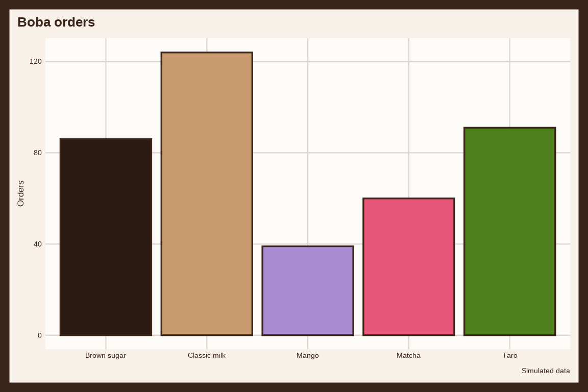

## Capybara

[`theme_capybara()`](https://mjfrigaard.github.io/ggzoomer/reference/theme_capybara.md):
Capybaras are the largest living rodents and a famously calm internet
mascot (see [Capybara](https://en.wikipedia.org/wiki/Capybara) on
Wikipedia). Capybaras became a figure in meme culture in the 2020s. A
common meme format pairs a capybara with the song “After Party” by Don
Toliver, and a song about capybaras became a TikTok hit in 2022.
Capybaras also stand for calm. People see them as unflappable, and their
personalities have been called “buddha-like.”

The palette follows the [“After Party” single
cover](https://en.wikipedia.org/wiki/File:Don_Toliver_-_After_Party_%28single_cover%29.jpeg)
that the article’s capybara memes pair with: a purple lowrider hearse,
lavender chrome, a near black shadow, the gray signpost and ground, a
mauve HEAVEN sign, and the hand lettered title, all on cream paper. The
image shows a capybara standing on a sandy riverbank.


Image: Giles Laurent, [Wikimedia
Commons](https://commons.wikimedia.org/wiki/File:Capybaracropped.jpg),
CC BY-SA 4.0.

``` r

set.seed(1766)
capys <- data.frame(hour = 0:23)
capys$Grazing <- round(20 + 15 * sin((capys$hour - 6) / 24 * 2 * pi) + rnorm(24, 0, 2))
capys$Swimming <- round(10 + 8 * sin((capys$hour - 10) / 24 * 2 * pi) + rnorm(24, 0, 2))
capys <- reshape(capys, direction = "long", varying = c("Grazing", "Swimming"), v.names = "minutes",
  timevar = "activity", times = c("Grazing", "Swimming"))
ggplot(capys, aes(x = hour, y = minutes, colour = activity)) +
  geom_line(linewidth = 1) +
  labs(title = "A capybara's day", caption = "Simulated data", x = "Hour", y = "Minutes", colour = NULL) +
  theme_capybara(base_size = 13)
```

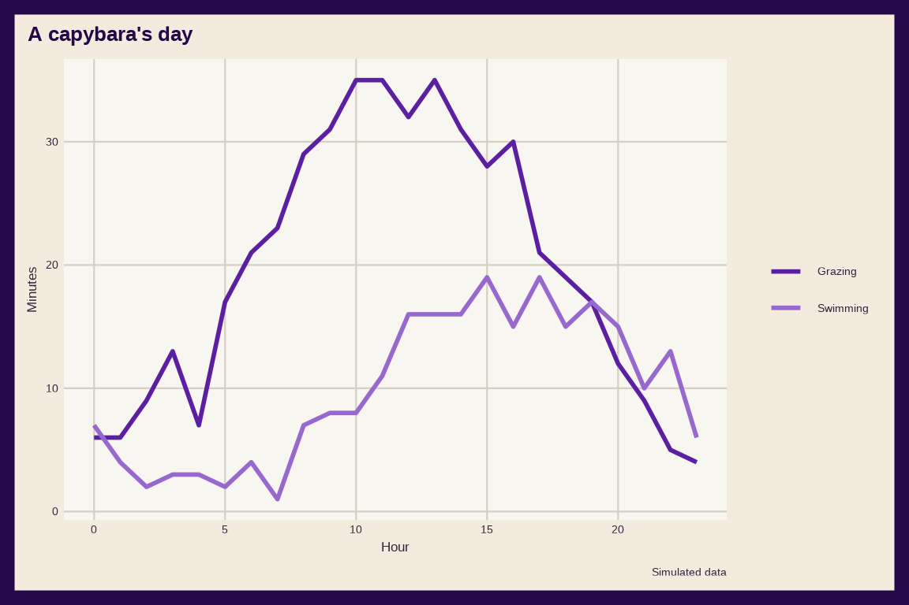

## Clean girl

[`theme_cleangirl()`](https://mjfrigaard.github.io/ggzoomer/reference/theme_cleangirl.md):
The clean girl aesthetic is a minimal beauty and wellness trend built on
slicked back hair, a no makeup makeup look, and a limited palette (see
[Clean girl
aesthetic](https://en.wikipedia.org/wiki/Clean_girl_aesthetic) on
Wikipedia). The clean girl aesthetic became a viral TikTok and Instagram
trend in 2021 and 2022. It moved beauty away from the heavy full glam of
the late 2010s and toward a curated, wellness focused identity. Critics
say the effortless look takes expensive upkeep and borrows styles from
Black and Latina women. By 2025, much of Gen Z had moved on to messier,
more maximalist looks.

The palette follows the polished, no makeup look: delicate gold jewelry,
an iced matcha latte, fluffy brown brows, glazed dewy skin, tinted
gloss, and neutral toned clothing. The image shows a single small gold
hoop earring.

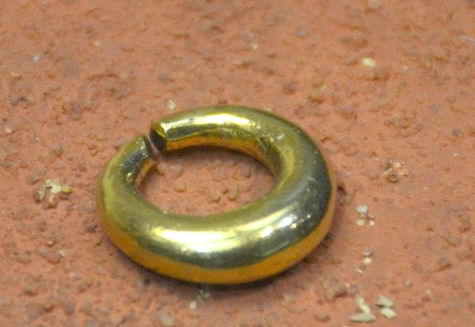

Image: Silar, [Wikimedia
Commons](https://commons.wikimedia.org/wiki/File:02024_0697_8_mm_diameter_gold_hoop_earring.jpg),
CC BY-SA 4.0.

``` r

set.seed(2022)
routine <- data.frame(step = rep(c("Cleanser", "Serum", "Moisturizer", "Sunscreen"), each = 150))
routine$minutes <- rgamma(600, shape = c(Cleanser = 4, Serum = 2, Moisturizer = 3, Sunscreen = 2)[routine$step], rate = 2)
routine$step <- factor(routine$step, levels = c("Cleanser", "Serum", "Moisturizer", "Sunscreen"))
ggplot(routine, aes(x = minutes, fill = step)) +
  geom_histogram(bins = 30) +
  labs(title = "Morning routine", caption = "Simulated data", x = "Minutes per step", fill = NULL) +
  theme_cleangirl(base_size = 13)
```

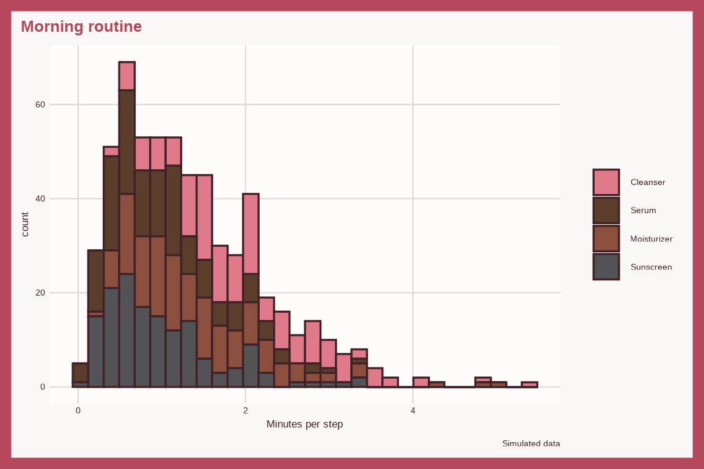

## Coastal grandmother

[`theme_coastal()`](https://mjfrigaard.github.io/ggzoomer/reference/theme_coastal.md):
Coastal grandmother is a relaxed style of linen, beach houses, and
seaside cooking (see [2020s in
fashion](https://en.wikipedia.org/wiki/2020s_in_fashion) on Wikipedia).
The coastal grandmother look borrows from the heroines of Nancy Meyers
films like Something’s Gotta Give. Gen Z and millennials treat it as an
escape from stress and burnout, a life of leisure instead of constant
striving. Gen Z makes it more accessible with texture and vintage
pieces; no beach house required. A younger, more casual version is
called coastal granddaughter.

The palette follows the Nancy Meyers wardrobe: soft blue, navy, beige
linen, camel cashmere, driftwood gray, and sea glass green on cream. The
image shows a vintage postcard of the bath houses on Craigville Beach,
Cape Cod.

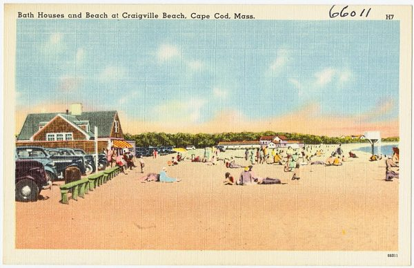

Image: Tichnor Bros. Inc., Boston, Mass., [Wikimedia
Commons](https://commons.wikimedia.org/wiki/File:Bath_house_and_beach_at_Craigville_Beach,_Cape_Cod,_Mass_(66011).jpg),
Public domain.

``` r

set.seed(2022)
beach <- data.frame(month = factor(rep(month.abb[5:9], each = 3), levels = month.abb[5:9]),
  activity = rep(c("Beach walks", "Farmers market", "Cooking"), 5))
beach$hours <- round(runif(15, 4, 20))
ggplot(beach, aes(x = month, y = hours, fill = activity)) +
  geom_col() +
  labs(title = "Summer on the coast", caption = "Simulated data", x = NULL, y = "Hours", fill = NULL) +
  theme_coastal(base_size = 13)
```

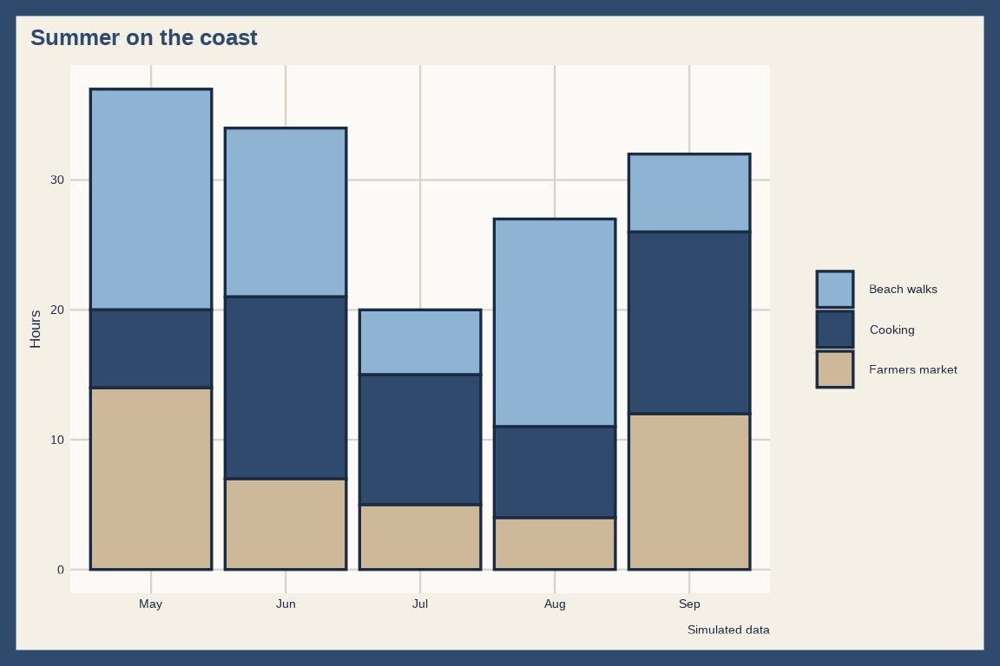

## Coquette

[`theme_coquette()`](https://mjfrigaard.github.io/ggzoomer/reference/theme_coquette.md):
The coquette aesthetic is a 2020s fashion trend of bows, lace, ribbons,
and pastels (see [Coquette
aesthetic](https://en.wikipedia.org/wiki/Coquette_aesthetic) on
Wikipedia). Coquette is a 2020s Gen Z trend that reclaims hyper
femininity as self expression. Unlike the girlboss era, it treats
softness as strength. On TikTok, \#coquetteaesthetic has passed 18
billion views, and Lana Del Rey, Sabrina Carpenter, and Jennie have all
embraced the look. Critics call it regressive, while fans see a
celebration of vulnerability and individuality.

The palette follows the hyper feminine wardrobe: ballet pink bows,
ribbon red hearts, pastel lavender and baby blue, pearls, and deep
cherry. The image shows an 1880s tobacco card portrait of Marie
Antoinette.

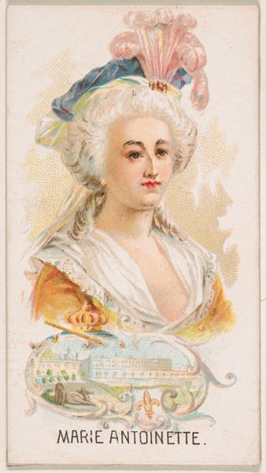

Image: Kinney Brothers Tobacco Company, [Wikimedia
Commons](https://commons.wikimedia.org/wiki/File:Marie_Antoinette,_from_Leaders_series_(N222)_issued_by_Kinney_Bros._MET_DPB872310.jpg),
CC0.

``` r

set.seed(1770)
bows <- data.frame(fabric = sample(c("Satin", "Velvet", "Lace", "Tulle", "Chiffon"), 300, replace = TRUE),
  item = sample(c("Hair bow", "Ribbon", "Lace top"), 300, replace = TRUE))
ggplot(bows, aes(x = item, fill = fabric)) +
  geom_bar(position = "dodge") +
  labs(title = "Coquette closet", caption = "Simulated data", x = NULL, y = "Items", fill = NULL) +
  theme_coquette(base_size = 13)
```

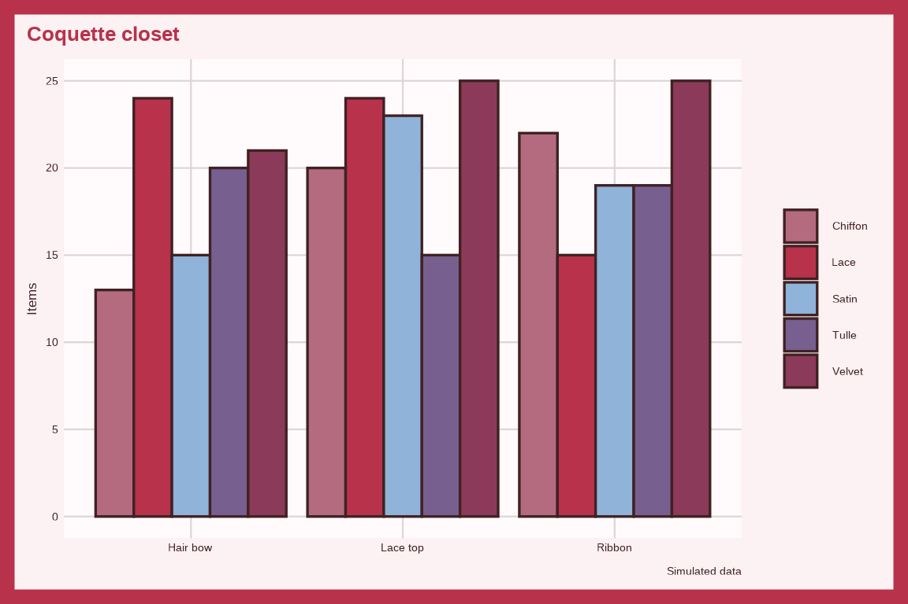

## Cottagecore

[`theme_cottagecore()`](https://mjfrigaard.github.io/ggzoomer/reference/theme_cottagecore.md):
Cottagecore is an internet aesthetic that romanticizes rural life:
gardens, baking, and handmade things (see
[Cottagecore](https://en.wikipedia.org/wiki/Cottagecore) on Wikipedia).
Cottagecore gives Gen Z an escape from hustle culture, consumerism, and
the stress of modern technology. It offers calm and a sense of control
in a chaotic world. It also fits Gen Z’s values: thrifting, slow
fashion, and eco consciousness. The aesthetic reimagines rural life as a
safe, inclusive space, often blended with queer and feminist ideals.

The palette follows the pastoral palette of greens, browns, and creams
with its motifs: sage, toadstool red, bee yellow, bark brown, wildflower
lilac, and moss. The image shows Anne Hathaway’s Cottage, a thatched
cottage and garden in Warwickshire.

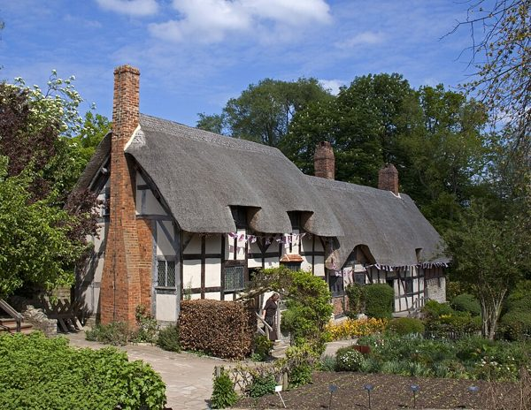

Image: Tony Hisgett from Birmingham, UK, [Wikimedia
Commons](https://commons.wikimedia.org/wiki/File:Anne_Hathaways_Cottage_1_(5662418953).jpg),
CC BY 2.0.

``` r

set.seed(2018)
garden <- data.frame(week = rep(1:12, 3), crop = rep(c("Tomatoes", "Herbs", "Strawberries"), each = 12))
garden$harvest <- round(pmax(0, c(Tomatoes = 1.2, Herbs = 0.6, Strawberries = 0.9)[garden$crop] * garden$week + rnorm(36, 0, 1.5)), 1)
ggplot(garden, aes(x = week, y = harvest, colour = crop)) +
  geom_line(linewidth = 1) +
  geom_point() +
  labs(title = "Cottage garden harvest", caption = "Simulated data", x = "Week", y = "Harvest (lbs)", colour = NULL) +
  theme_cottagecore(base_size = 13)
```

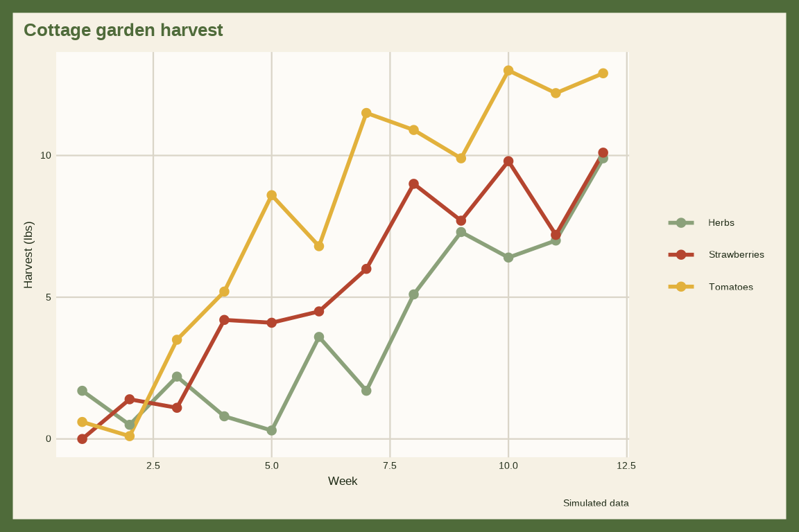

## Dark academia

[`theme_darkacademia()`](https://mjfrigaard.github.io/ggzoomer/reference/theme_darkacademia.md):
Dark academia is an internet aesthetic built around old libraries,
tweed, and classic literature (see [Dark
academia](https://en.wikipedia.org/wiki/Dark_academia) on Wikipedia).
Dark academia spread through Tumblr and TikTok. Tumblr’s 2021 year in
review ranked it the platform’s second most popular aesthetic, and about
48% of Tumblr users are Gen Z. Commentators link its appeal to digital
fatigue and a hunger for reflection and an intellectual identity.
Critics point out that it has since been sold back as a lifestyle brand.

The palette follows a dim library with black coffee: parchment, brown
tweed, burgundy, forest green, charcoal, and dark oak. The image shows a
Gothic spiral staircase inside St. Barbara’s Church in Kutna Hora.

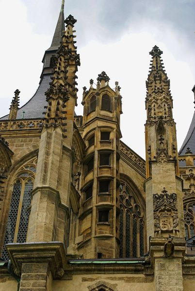

Image: Txllxt TxllxT, [Wikimedia
Commons](https://commons.wikimedia.org/wiki/File:Kutn%C3%A1_Hora_-_View_North_on_Gothic_spiral_staircase.jpg),
CC BY-SA 4.0.

``` r

set.seed(1891)
books <- data.frame(genre = rep(c("Poetry", "Gothic novels", "Philosophy", "Greek myths"), each = 100))
books$pages <- round(rnorm(400, mean = c(Poetry = 120, "Gothic novels" = 380, Philosophy = 260, "Greek myths" = 320)[books$genre], sd = 50))
ggplot(books, aes(x = pages, y = genre, fill = genre)) +
  geom_boxplot(show.legend = FALSE) +
  labs(title = "The reading list", caption = "Simulated data", x = "Pages", y = NULL) +
  theme_darkacademia(base_size = 13)
```

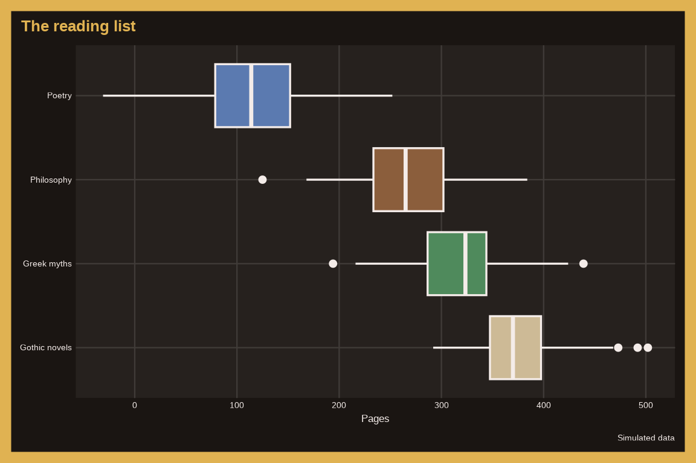

With `mode = "light"`:

``` r

last_plot() + theme_darkacademia(base_size = 13, mode = "light")
```

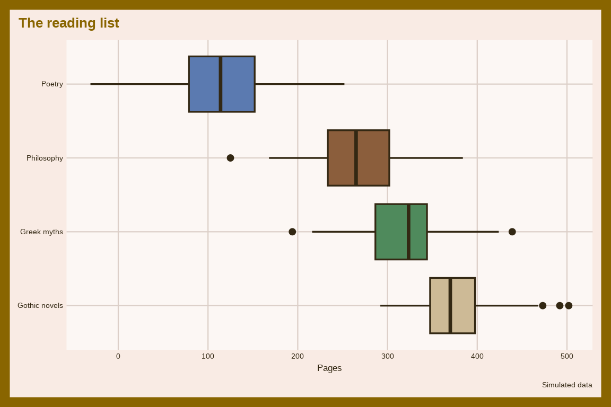

## Digicam

[`theme_digicam()`](https://mjfrigaard.github.io/ggzoomer/reference/theme_digicam.md):
Digital point and shoot cameras from the 2000s are back for their flash
heavy, slightly blurry photos (see [Digital
camera](https://en.wikipedia.org/wiki/Digital_camera) on Wikipedia). Gen
Z revived early 2000s digital cameras around 2022 on TikTok and
Instagram. Many pulled them out of their parents’ drawers or bought them
secondhand. The grainy, flash heavy shots feel more authentic than
heavily processed phone photos. There is nostalgia, too: many of these
users grew up being photographed on the same cameras.

The palette follows flash heavy early 2000s photos against a dark
background: a metallic silver body, the orange date stamp, LCD blue,
candy pink, gunmetal, and flash white. The image shows the front and
back of a Canon PowerShot A95.

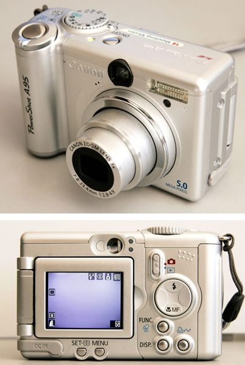

Image: Fir0002 (composite version by Matt57), [Wikimedia
Commons](https://commons.wikimedia.org/wiki/File:Canon_PowerShot_A95_-_front_and_back.jpg),
GFDL 1.2.

``` r

set.seed(2004)
cams <- data.frame(megapixels = round(runif(250, 2, 12), 1))
cams$price <- round(40 + 6 * cams$megapixels + rnorm(250, 0, 15))
cams$condition <- sample(c("Like new", "Used", "Scratched"), 250, replace = TRUE)
ggplot(cams, aes(x = megapixels, y = price, colour = condition)) +
  geom_point(size = 2, alpha = 0.8) +
  labs(title = "Resale digicams", caption = "Simulated data", x = "Megapixels", y = "Price ($)", colour = NULL) +
  theme_digicam(base_size = 13)
```

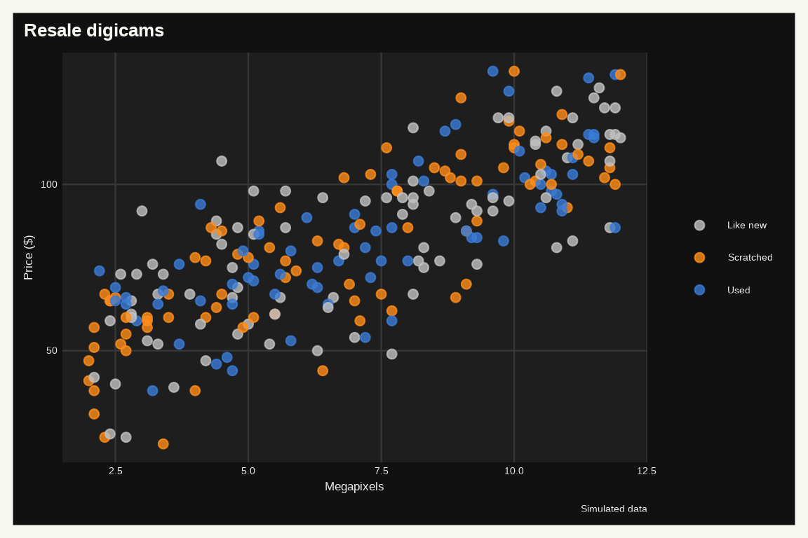

With `mode = "light"`:

``` r

last_plot() + theme_digicam(base_size = 13, mode = "light")
```

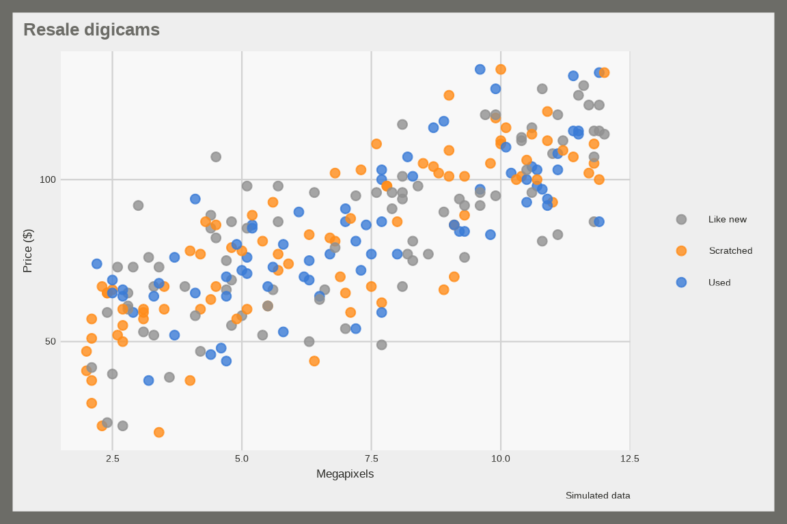

## Doomscroll

[`theme_doomscroll()`](https://mjfrigaard.github.io/ggzoomer/reference/theme_doomscroll.md):
Doomscrolling is spending far too long scrolling through upsetting or
endless feeds (see
[Doomscrolling](https://en.wikipedia.org/wiki/Doomscrolling) on
Wikipedia). Doomscrolling is endlessly scrolling bad news, usually late
at night. A 2024 study found that 53% of Gen Z say they doomscroll,
compared with about a third of Americans overall. Studies link the habit
to stress and anxiety. It even spills into spending: Fortune reported in
2024 that Gen Z spent 21% more on holiday shopping to cope.

The palette follows a glowing phone in a dark room: screen glow blue,
notification red, blue light, slate gray, breaking news red, and dim
white. The image shows a thumb scrolling a phone screen in the dark.

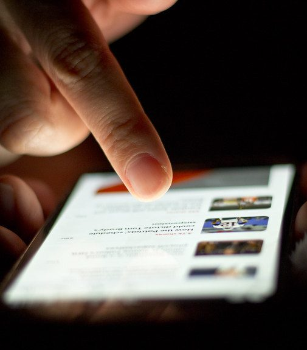

Image: Japanexperterna.se, [Wikimedia
Commons](https://commons.wikimedia.org/wiki/File:Scrolling_on_phone_(cropped_again).jpg),
CC BY-SA 2.0.

``` r

set.seed(2020)
scroll <- data.frame(hour = rep(0:23, 2), day = rep(c("Weekday", "Weekend"), each = 24))
scroll$minutes <- round(pmax(0, 25 + 20 * cos((scroll$hour - 23) / 24 * 2 * pi) + ifelse(scroll$day == "Weekend", 10, 0) + rnorm(48, 0, 4)))
ggplot(scroll, aes(x = hour, y = minutes, fill = day)) +
  geom_area(alpha = 0.8, position = "identity") +
  labs(title = "Late night doomscrolling", caption = "Simulated data", x = "Hour", y = "Minutes", fill = NULL) +
  theme_doomscroll(base_size = 13)
```

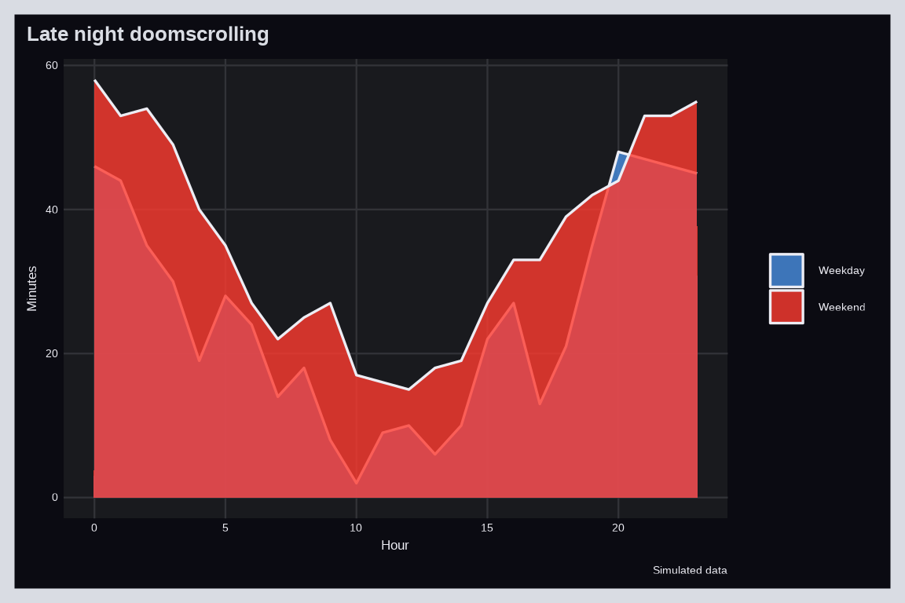

With `mode = "light"`:

``` r

last_plot() + theme_doomscroll(base_size = 13, mode = "light")
```

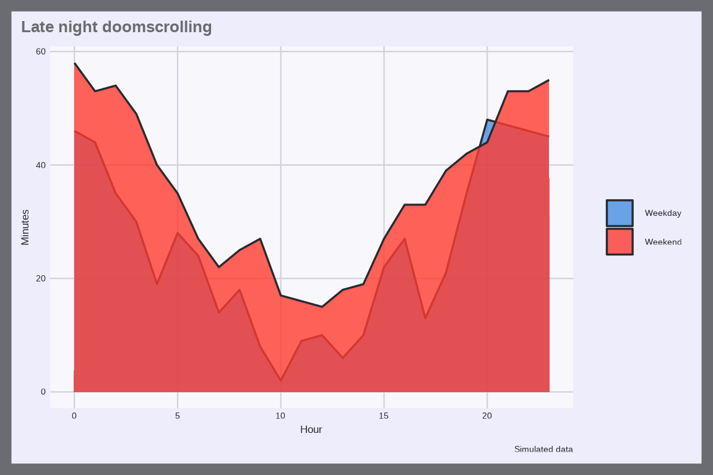

## E-girl

[`theme_egirl()`](https://mjfrigaard.github.io/ggzoomer/reference/theme_egirl.md):
E-girls and e-boys are a TikTok youth subculture that mixes emo, scene,
and mall goth fashion with anime and K-pop style (see [E-girl and e-boy
subculture](https://en.wikipedia.org/wiki/E-girl_and_e-boy_subculture)
on Wikipedia). E-girls and e-boys reached the mainstream in 2019 through
TikTok transformation videos. TikTok lacked Instagram’s polish and
filters, so the look pushed back on perfectly edited influencer photos.
In 2020, “e-girl style” was a top 10 trending fashion term on Google,
and celebrities like Dua Lipa copied its bleached stripes. Designers at
Celine later built collections around e-boy style.

The palette follows the e-girl look: neon pink and blue dyed hair,
silver chains, a red band tee print, bleached blonde streaks, and anime
pink blush on black. The image shows an e-girl’s striped sleeves,
layered chain necklaces, and black band tee.

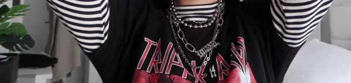

Image: Irisloveunicorns, [Wikimedia
Commons](https://commons.wikimedia.org/wiki/File:E-girl.png), CC BY 3.0
(cropped).

``` r

set.seed(2019)
looks <- data.frame(item = sample(c("Chains", "Striped sleeves", "Heart stamps", "Split dye hair", "Platform shoes"),
  500, replace = TRUE, prob = c(0.3, 0.25, 0.2, 0.15, 0.1)))
looks$item <- factor(looks$item, levels = names(sort(table(looks$item))))
ggplot(looks, aes(y = item, fill = item)) +
  geom_bar(show.legend = FALSE) +
  labs(title = "E-girl transformation videos", subtitle = "What each look added",
       caption = "Simulated data", x = "Videos", y = NULL) +
  theme_egirl(base_size = 13)
```

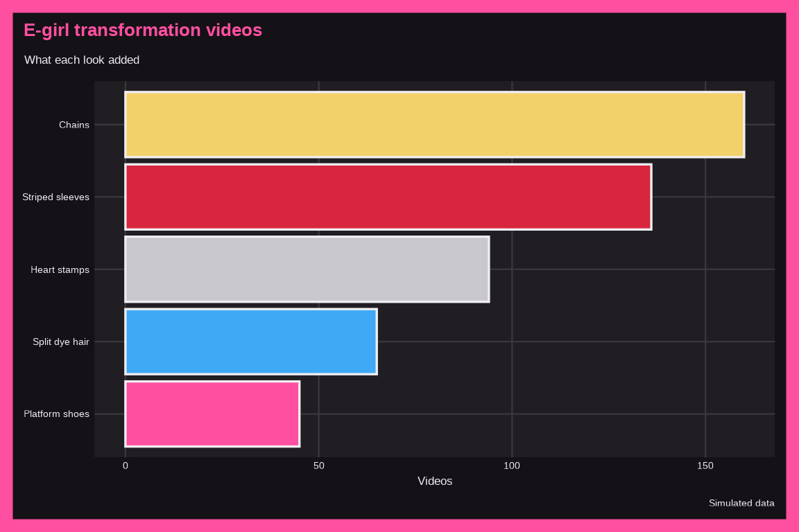

With `mode = "light"`:

``` r

last_plot() + theme_egirl(base_size = 13, mode = "light")
```

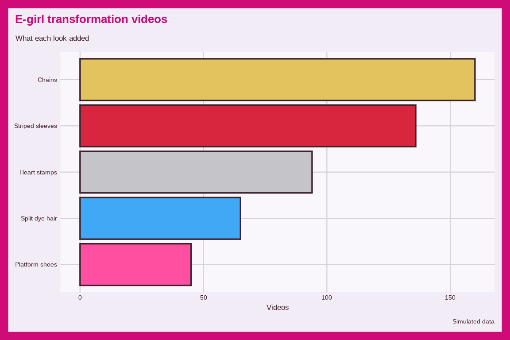

## Fidget toy

[`theme_fidget()`](https://mjfrigaard.github.io/ggzoomer/reference/theme_fidget.md):
Fidget toys (spinners, cubes, pop its, and bike chains) are small things
to keep your hands busy (see [Fidget
toy](https://en.wikipedia.org/wiki/Fidget_toy) on Wikipedia). Fidget
spinners went viral in 2017. Fidget toys came back through TikTok videos
of pop its, slime, and kinetic sand under hashtags like \#FidgetToys.
Gen Z uses them as screen free stress relief and as focus aids while
studying or working. For some young adults, they are also simply
nostalgic and fun.

The palette follows rainbow pop its and spinners: red, sunny yellow,
lime, sky blue, purple, and hot pink. The image shows a bike chain
fidget toy on lined paper.

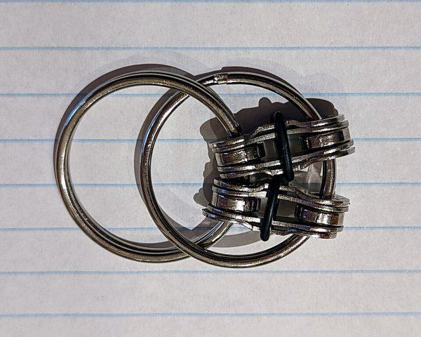

Image: Ike9898, [Wikimedia
Commons](https://commons.wikimedia.org/wiki/File:A_%22bike_chain%22_type_fidget_toy.jpg),
CC BY-SA 4.0.

``` r

set.seed(2017)
spins <- data.frame(toy = rep(c("Spinner", "Cube", "Pop it", "Bike chain"), each = 100))
spins$seconds <- rexp(400, rate = c(Spinner = 1 / 60, Cube = 1 / 30, "Pop it" = 1 / 45, "Bike chain" = 1 / 20)[spins$toy])
ggplot(spins, aes(x = toy, y = seconds, colour = toy)) +
  geom_jitter(width = 0.2, alpha = 0.6, show.legend = FALSE) +
  labs(title = "How long a fidget lasts", caption = "Simulated data", x = NULL, y = "Seconds") +
  theme_fidget(base_size = 13)
```

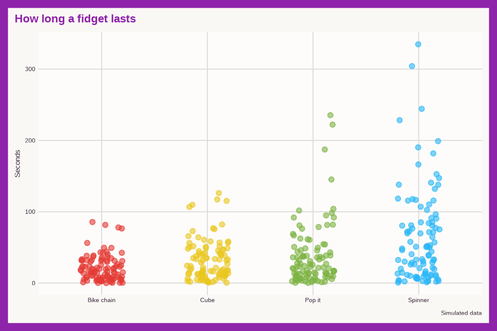

## Frog

[`theme_frog()`](https://mjfrigaard.github.io/ggzoomer/reference/theme_frog.md):
Frogs are tailless amphibians and a cottagecore and goblincore icon (see
[Frog](https://en.wikipedia.org/wiki/Frog) on Wikipedia). Gen Z’s
favorite frog is Animal Crossing’s Froggy Chair, a green seat with a
wide red mouth. Fans get Froggy Chair tattoos, bake Froggy Chair cakes,
and print it on shirts. Frogcore extends the look to frog hoodies, rain
boots, and slippers. Frog memes, from wholesome mental health posts to
Arson Frog avatars, fill Gen Z feeds.

The palette follows Animal Crossing’s Froggy Chair and frog memes:
froggy green, the wide red mouth, pond blue, Arson Frog blue, moss, and
lily pad green on belly cream. The image shows a red eyed tree frog on a
branch.

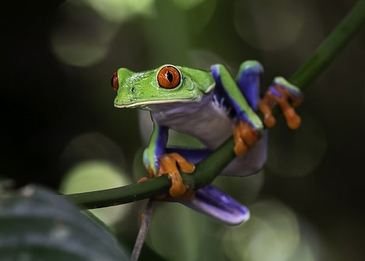

Image: Charlie Jackson, [Wikimedia
Commons](https://commons.wikimedia.org/wiki/File:Red-eyed_Leaf_Frog_(49661076226).jpg),
CC BY 2.0.

``` r

set.seed(1758)
frogs <- data.frame(species = rep(c("Tree frog", "Bullfrog", "Poison dart"), each = 150))
frogs$jump <- rnorm(450, mean = c("Tree frog" = 1.5, Bullfrog = 2, "Poison dart" = 0.6)[frogs$species], sd = 0.3)
ggplot(frogs, aes(x = jump, fill = species)) +
  geom_histogram(bins = 30, alpha = 0.8, position = "identity") +
  labs(title = "Frog jumps", caption = "Simulated data", x = "Jump distance (m)", fill = NULL) +
  theme_frog(base_size = 13)
```

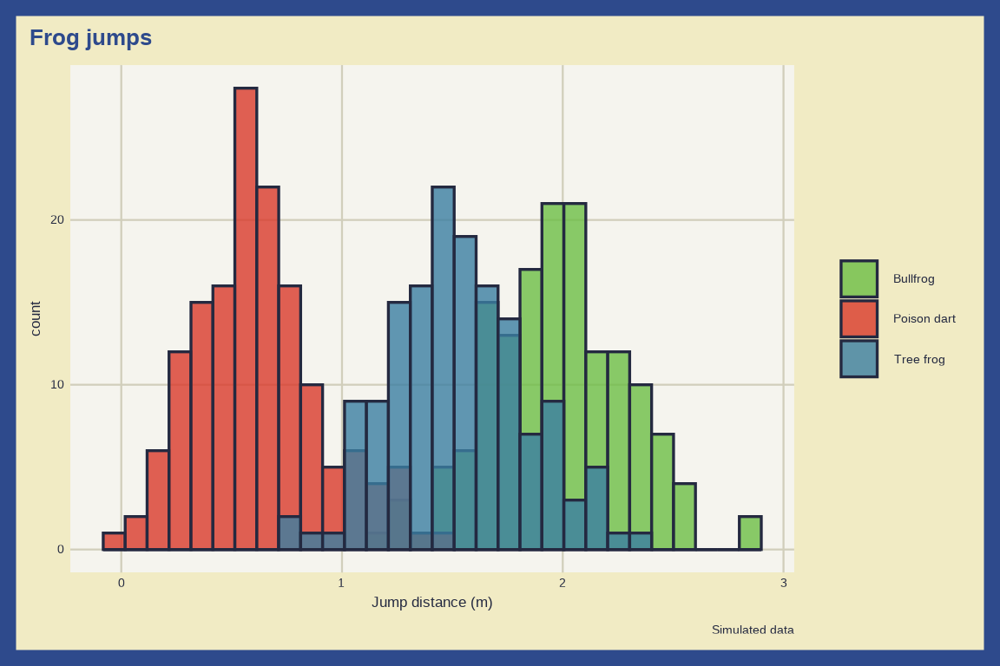

## Frutiger Aero

[`theme_frutigeraero()`](https://mjfrigaard.github.io/ggzoomer/reference/theme_frutigeraero.md):
Frutiger Aero is the glossy design style of the mid 2000s: bubbles,
water, grass, and blue skies (see [Frutiger
Aero](https://en.wikipedia.org/wiki/Frutiger_Aero) on Wikipedia).
Frutiger Aero came back on TikTok, Tumblr, and Reddit in 2022 and 2023.
Gen Z links it to a digital childhood of MSN Messenger and Windows
Vista. Essays frame it as optimism, a glossy contrast to flat,
minimalist design and modern cynicism. Even design writers admit it’s
hard to say exactly why it resonates.

The palette follows glossy Vista era glass and water: sky blue, grass
green, deep ocean blue, lime, aqua, and bubble cyan. The image shows
soap bubbles floating over sunlit grass.

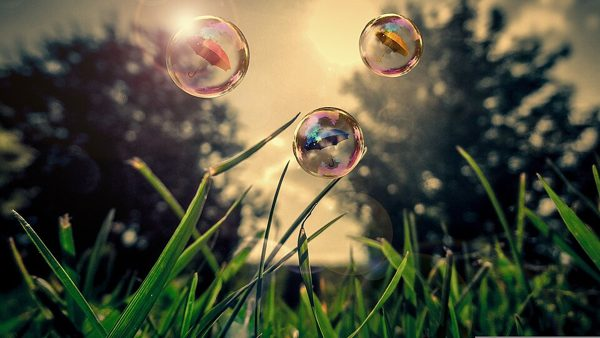

Image: ThePixelman on Pixabay, [Wikimedia
Commons](https://commons.wikimedia.org/wiki/File:Frutiger_Aero_Bubbles_And_Grass.jpg),
CC0.

``` r

set.seed(2007)
aero <- data.frame(year = 2004:2013)
aero$Gloss <- round(100 * plogis((aero$year - 2007) * 1.2) * (1 - plogis((aero$year - 2011) * 1.5)))
aero$Flat <- round(100 * plogis((aero$year - 2011) * 1.5))
aero <- reshape(aero, direction = "long", varying = c("Gloss", "Flat"), v.names = "share", timevar = "style", times = c("Gloss", "Flat"))
ggplot(aero, aes(x = year, y = share, colour = style)) +
  geom_line(linewidth = 1.2) +
  labs(title = "Gloss to flat", caption = "Simulated data", x = NULL, y = "Share of app icons (%)", colour = NULL) +
  theme_frutigeraero(base_size = 13)
```

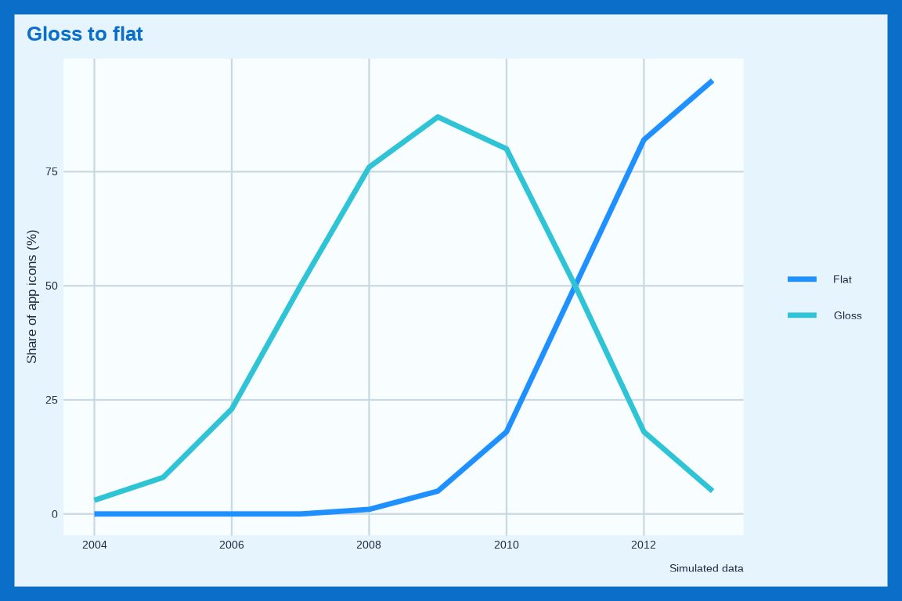

## Goblincore

[`theme_goblincore()`](https://mjfrigaard.github.io/ggzoomer/reference/theme_goblincore.md):
Goblincore celebrates the less pretty side of nature: moss, mushrooms,
snails, and found objects (see
[Goblincore](https://en.wikipedia.org/wiki/Goblincore) on Wikipedia).
Goblincore is a grungier, moodier cousin of cottagecore. It grew on
TikTok in 2021 and ties into Gen Z’s interest in nature and
sustainability. The trend pulls people away from screens and into
forests and empty lots. Coverage reads its anti consumerist attitude and
love of imperfection as a response to an unsettling, post pandemic
world.

The palette follows mud, moss, and fungi in natural earth tones: moss
green, toadstool red, mushroom beige, lichen sage, mud brown, and olive
on soil black. The image shows a still life of old vases, a framed
photo, and an animal skull.

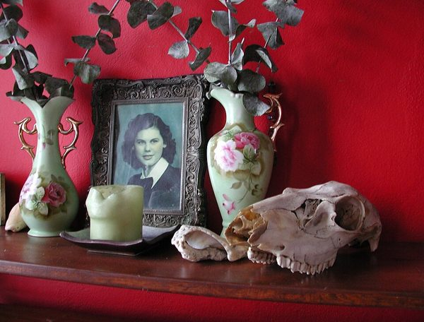

Image: Bart Everson, [Wikimedia
Commons](https://commons.wikimedia.org/wiki/File:Still_life_with_animal_skull_and_vases.jpg),
CC BY 2.0.

``` r

set.seed(2019)
finds <- data.frame(find = sample(c("Mushrooms", "Moss", "Snail shells", "Bones", "Shiny rocks"), 300, replace = TRUE,
  prob = c(0.3, 0.25, 0.2, 0.1, 0.15)))
finds$find <- factor(finds$find, levels = names(sort(table(finds$find))))
ggplot(finds, aes(y = find, fill = find)) +
  geom_bar(show.legend = FALSE) +
  labs(title = "Forest walk finds", caption = "Simulated data", x = "Count", y = NULL) +
  theme_goblincore(base_size = 13)
```

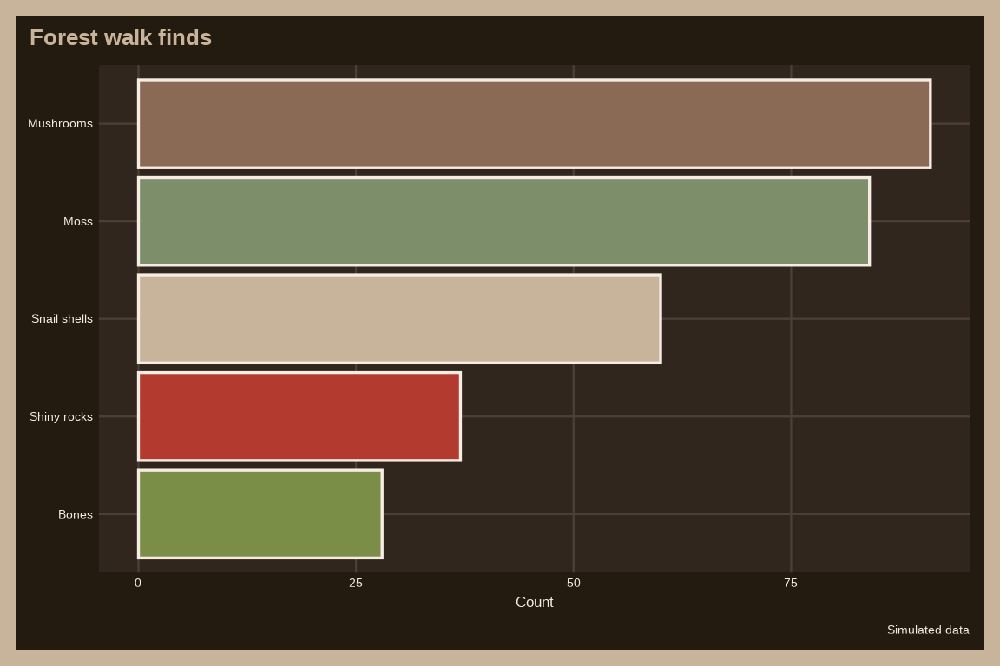

With `mode = "light"`:

``` r

last_plot() + theme_goblincore(base_size = 13, mode = "light")
```

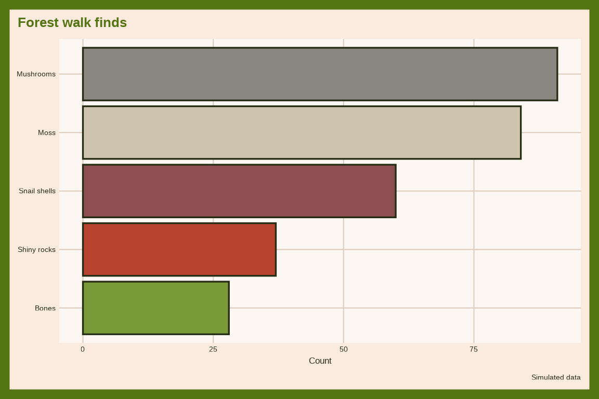

## Gorpcore

[`theme_gorpcore()`](https://mjfrigaard.github.io/ggzoomer/reference/theme_gorpcore.md):
Gorpcore is hiking gear (shell jackets, fleece, and trail shoes) worn as
everyday streetwear (see
[Gorpcore](https://en.wikipedia.org/wiki/Gorpcore) on Wikipedia).
Gorpcore turns outdoor gear into everyday style. It started out male
led, but it has reached new heights on TikTok and Pinterest, especially
among Gen Z women. Coverage ties it to the mental health benefits of
time outside, tech fatigue after COVID, and Gen Z’s taste for
sustainable goods. You don’t have to hike to wear it.

The palette follows technical outdoor gear worn as streetwear: safety
orange, forest green, glacier blue, olive drab, trail tan, and stone
gray, with black nylon. The image shows outdoor jackets and pants
hanging in a store.

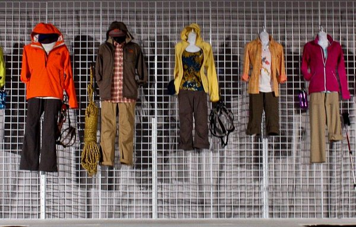

Image: Joe Parks from Berkeley, CA, [Wikimedia
Commons](https://commons.wikimedia.org/wiki/File:The_North_Face_Outdoor_Sportswear_-_Flickr_-_Joe_Parks_(cropped).jpg),
CC BY 2.0.

``` r

set.seed(2017)
gear <- data.frame(item = rep(c("Shell jacket", "Fleece", "Trail shoes"), each = 120))
gear$price <- rlnorm(360, meanlog = log(c("Shell jacket" = 250, Fleece = 120, "Trail shoes" = 140)[gear$item]), sdlog = 0.25)
ggplot(gear, aes(x = price, fill = item)) +
  geom_density(alpha = 2/3) +
  labs(title = "Gorpcore price tags", caption = "Simulated data", x = "Price ($)", fill = NULL) +
  theme_gorpcore(base_size = 13)
```

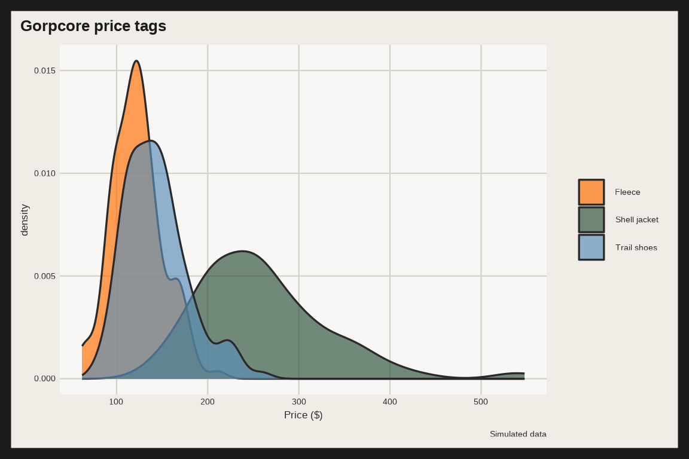

## Group chat

[`theme_groupchat()`](https://mjfrigaard.github.io/ggzoomer/reference/theme_groupchat.md):
Group chats are where friends plan, share memes, and leave each other on
read (see [Online chat](https://en.wikipedia.org/wiki/Online_chat) on
Wikipedia). Group chats have become Gen Z’s third place, taking over
from malls and coffee shops as the place to hang out. Their humor runs
on memes that reference earlier memes. A 2025 Giphy survey found that
about 89% of Gen Z and millennials check with their group chat before
major life decisions. Snap found that nearly two thirds of Gen Z
shoppers bought something after friends approved it in the chat.

The palette follows stacked chat bubbles and emoji: iMessage blue, SMS
green, emoji yellow, heart red, typing gray, and dark mode black. The
image shows a group conversation in a messaging app.

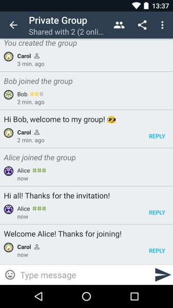

Image: Sublime Software Ltd., [Wikimedia
Commons](https://commons.wikimedia.org/wiki/File:Screenshot_of_Briar_04_private_group.png),
CC BY 4.0.

``` r

set.seed(2009)
chat <- data.frame(friend = rep(c("Ari", "Bo", "Cam", "Dev", "Eli"), each = 7), day = rep(1:7, 5))
chat$messages <- rpois(35, lambda = c(Ari = 60, Bo = 15, Cam = 35, Dev = 5, Eli = 25)[chat$friend])
ggplot(chat, aes(x = day, y = messages, fill = friend)) +
  geom_col() +
  labs(title = "Who carries the group chat", caption = "Simulated data", x = "Day", y = "Messages", fill = NULL) +
  theme_groupchat(base_size = 13)
```

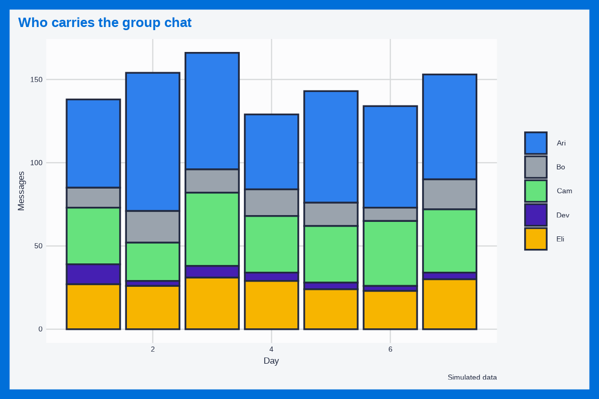

## Indie sleaze

[`theme_indiesleaze()`](https://mjfrigaard.github.io/ggzoomer/reference/theme_indiesleaze.md):
Indie sleaze is the messy, flash photo party style of 2006 to 2012, now
back on social media (see [Indie
sleaze](https://en.wikipedia.org/wiki/Indie_sleaze) on Wikipedia). Trend
forecasters predicted an indie sleaze revival at the start of 2022, and
TikTok amplified it. For younger Gen Z, it is nostalgia for an era they
were too young to live through. The messy, flash lit look is also a
counterpoint to the polished clean girl aesthetic and a break from hyper
perfection.

The palette follows harsh flash photos in dark clubs: red eye red, neon
rave pink, washed denim, flash white, smudged eyeliner gray, and worn
leather. The image shows a singer performing under a stage light in
2007.

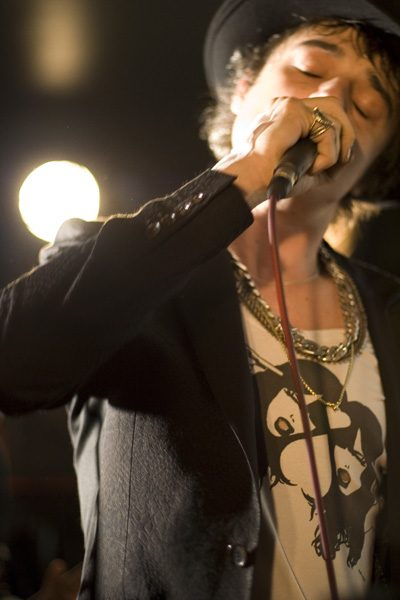

Image: Dale Harvey, [Wikimedia
Commons](https://commons.wikimedia.org/wiki/File:Pete_doherty_2007.jpg),
CC BY 2.0.

``` r

set.seed(2007)
shows <- data.frame(venue = rep(c("Basement", "Club", "Festival"), each = 150))
shows$minutes <- rnorm(450, mean = c(Basement = 35, Club = 55, Festival = 75)[shows$venue], sd = 10)
ggplot(shows, aes(x = venue, y = minutes, fill = venue)) +
  geom_violin(show.legend = FALSE) +
  labs(title = "Set lengths", caption = "Simulated data", x = NULL, y = "Minutes") +
  theme_indiesleaze(base_size = 13)
```

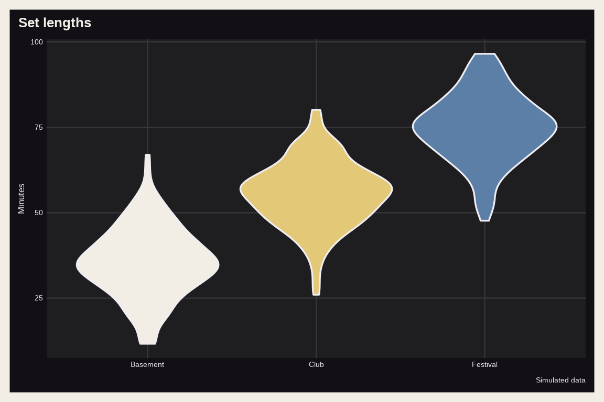

With `mode = "light"`:

``` r

last_plot() + theme_indiesleaze(base_size = 13, mode = "light")
```

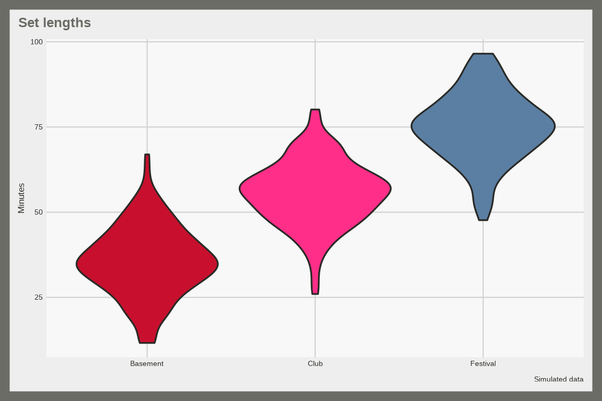

## Kidcore

[`theme_kidcore()`](https://mjfrigaard.github.io/ggzoomer/reference/theme_kidcore.md):
Kidcore is a bright, nostalgic aesthetic of primary colors, beads,
stickers, and childhood toys (see
[Kidcore](https://en.wikipedia.org/wiki/Kidcore) on Wikipedia). Trend
researchers tracked kidcore as early as 2015 among millennials, but Gen
Z pushed it further on TikTok. It feeds the generation’s nostalgia for
eras they barely experienced. Commentators describe it as escapism and
comfort, even a form of self care. Brands now use its bright, toy like
look to speak to young audiences.

The palette follows Fisher Price primaries and toy colors: red, yellow,
blue, crayon green, tangerine orange, and grape purple. The image shows
a heart shaped rainbow bead necklace.

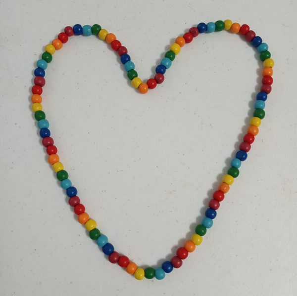

Image: Brainy J, [Wikimedia
Commons](https://commons.wikimedia.org/wiki/File:Rainbow_bead_necklace_-_heart_shaped.jpg),
CC0.

``` r

set.seed(2001)
beads <- data.frame(color = sample(c("Red", "Yellow", "Blue", "Green", "Orange", "Purple"), 600, replace = TRUE))
beads$color <- factor(beads$color, levels = c("Red", "Yellow", "Blue", "Green", "Orange", "Purple"))
beads$kit <- sample(c("Bracelet", "Necklace"), 600, replace = TRUE)
ggplot(beads, aes(x = kit, fill = color)) +
  geom_bar(position = "fill") +
  labs(title = "Bead kit colors", caption = "Simulated data", x = NULL, y = "Share of beads", fill = NULL) +
  theme_kidcore(base_size = 13)
```

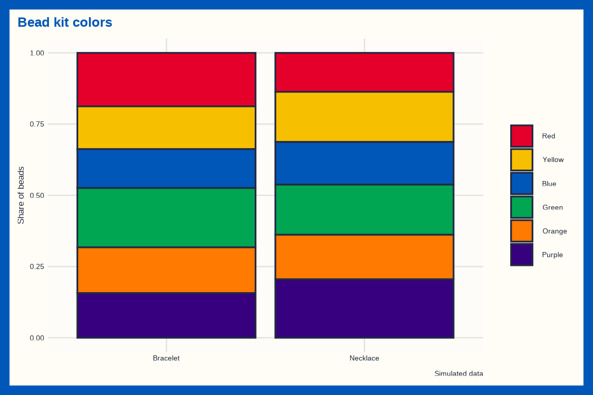

## LED strip

[`theme_ledstrip()`](https://mjfrigaard.github.io/ggzoomer/reference/theme_ledstrip.md):
LED strip lights are the adhesive color changing lights that line
bedroom ceilings and desks (see [LED strip
light](https://en.wikipedia.org/wiki/LED_strip_light) on Wikipedia). LED
strips are often called TikTok lights. Refinery29 tracked the trend on
TikTok from 2020 onward and called it Gen Z’s answer to the fairy lights
of the 2010s. For teens in bare bedrooms or dorms, a cheap strip of
lights is one of the few ways to make a space their own. Recent coverage
notes Gen Z lighting turning softer and dimmer.

The palette follows TikTok lights along a dark bedroom wall: hot pink,
electric blue, purple, red, cyan, and green. The image shows a strip of
cyan LED light under an airplane cabin shelf.

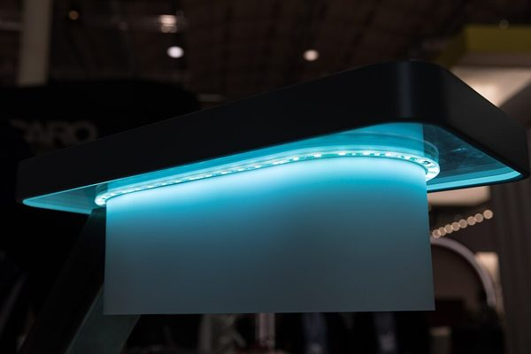

Image: Matti Blume, [Wikimedia
Commons](https://commons.wikimedia.org/wiki/File:Passenger_Experience_Week_2018,_Hamburg_(1X7A3748).jpg),
CC BY-SA 4.0.

``` r

set.seed(2016)
leds <- data.frame(setting = sample(c("Static", "Fade", "Music sync", "Rainbow", "Sunset"), 300, replace = TRUE,
  prob = c(0.25, 0.3, 0.15, 0.2, 0.1)))
leds$hours <- rgamma(300, shape = 3, rate = 0.8)
ggplot(leds, aes(x = setting, y = hours, fill = setting)) +
  geom_boxplot(show.legend = FALSE) +
  labs(title = "LED strip settings", caption = "Simulated data", x = NULL, y = "Hours on per night") +
  theme_ledstrip(base_size = 13)
```

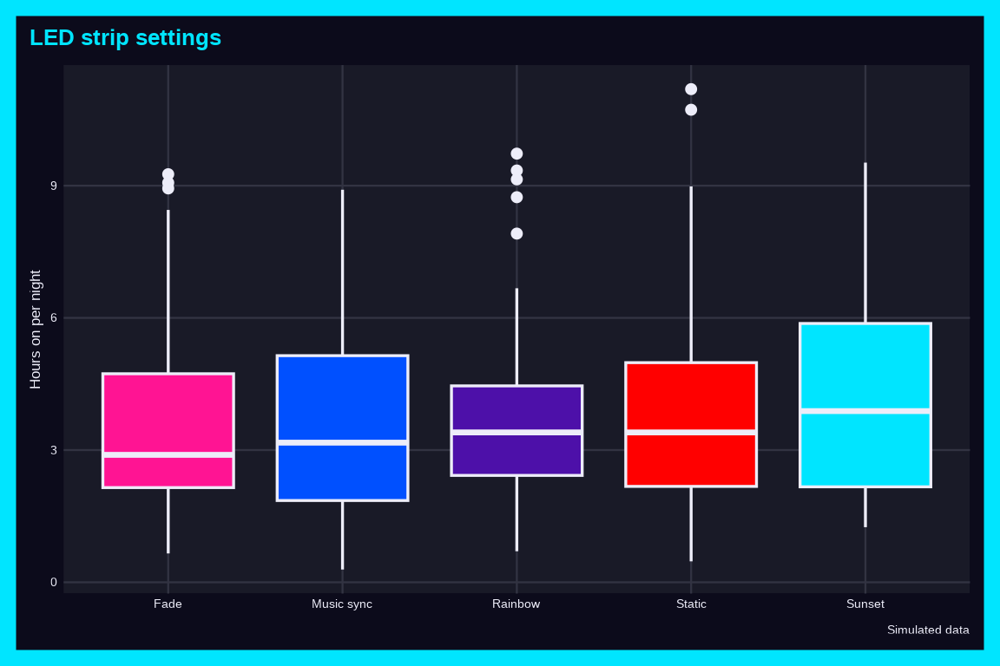

With `mode = "light"`:

``` r

last_plot() + theme_ledstrip(base_size = 13, mode = "light")
```


## Liminal space

[`theme_liminal()`](https://mjfrigaard.github.io/ggzoomer/reference/theme_liminal.md):
Liminal space is an internet aesthetic of empty in between places:
hallways, waiting rooms, and closed malls (see [Liminal
space](https://en.wikipedia.org/wiki/Liminal_space) on Wikipedia).
Liminal space images began with a 2019 4chan post that spawned the
Backrooms, then spread across Reddit and TikTok. Commentators tie their
appeal to childhood memories of malls and schools. Empty streets during
the pandemic lockdowns made the feeling familiar. YPulse reported in
2026 that Gen Z loves films and shows set in liminal spaces.

The palette follows empty Backrooms hallways and dated malls:
fluorescent yellow, stained carpet beige, pool tile aqua, concrete gray,
mall teal, and night parking lot orange. The image shows an empty
carpeted hallway in the Stanley Hotel.


Image: Larry D. Moore, [Wikimedia
Commons](https://commons.wikimedia.org/wiki/File:Corridor_Stanley_Hotel_Estes_Park_Colorado_2024.jpg),
CC BY 4.0.

``` r

set.seed(2019)
halls <- data.frame(place = rep(c("Hotel hallway", "Empty mall", "Parking garage", "Pool room"), each = 100))
halls$eeriness <- pmin(10, pmax(0, rnorm(400, mean = c("Hotel hallway" = 7, "Empty mall" = 6, "Parking garage" = 5, "Pool room" = 8)[halls$place], sd = 1.5)))
ggplot(halls, aes(x = eeriness, y = place, fill = place)) +
  geom_violin(show.legend = FALSE) +
  labs(title = "How eerie is it?", caption = "Simulated data", x = "Eeriness (0 to 10)", y = NULL) +
  theme_liminal(base_size = 13)
```


## Livestream

[`theme_livestream()`](https://mjfrigaard.github.io/ggzoomer/reference/theme_livestream.md):
Livestreaming is broadcasting video in real time, from gaming streams to
vlogs filmed on the street (see [Live
streaming](https://en.wikipedia.org/wiki/Live_streaming) on Wikipedia).
Twitch calls its core audience of Gen Z and younger millennials
Generation Twitch. Researchers find that Gen Z spends far more time on
video than older generations. Marketers report that interaction, not
passive watching, keeps them engaged. Emotes act as a shared shorthand,
with meanings unique to each streamer’s community.

The palette follows a Twitch stream: Twitch purple, the live red badge,
Prime blue, overlay green, ice white chat text, and chat panel gray. The
image shows a journalist livestreaming from a railway station.


Image: N509FZ, [Wikimedia
Commons](https://commons.wikimedia.org/wiki/File:CR_staff_and_PeopleRail_journalist_livestreaming_at_Beijing_Fengtai_Railway_Station_Exit_5_(20220620132147).jpg),
CC BY-SA 4.0.

``` r

set.seed(2011)
streams <- data.frame(category = rep(c("Gaming", "Just chatting", "Music", "IRL"), each = 150))
streams$viewers <- rlnorm(600, meanlog = c(Gaming = 5, "Just chatting" = 4.5, Music = 3.8, IRL = 4)[streams$category], sdlog = 1)
ggplot(streams, aes(x = viewers, fill = category)) +
  geom_histogram(bins = 30) +
  scale_x_log10() +
  labs(title = "Live viewers", caption = "Simulated data", x = "Viewers (log scale)", fill = NULL) +
  theme_livestream(base_size = 13)
```


With `mode = "light"`:

``` r

last_plot() + theme_livestream(base_size = 13, mode = "light")
```


## Matcha

[`theme_matcha()`](https://mjfrigaard.github.io/ggzoomer/reference/theme_matcha.md):
Matcha is finely ground Japanese green tea, now a cafe staple as a latte
(see [Matcha](https://en.wikipedia.org/wiki/Matcha) on Wikipedia). In
2025, BeverageDaily called matcha Gen Z’s avocado toast moment. Its
photogenic green suits Instagram and TikTok, where a new flavor or cup
design can go viral fast. Gen Z also picks matcha for its perceived
health benefits, dairy free options, and lower caffeine than coffee. The
whisking ritual signals that you’re in the know.

The palette follows a matcha latte layered over oat milk: ceremonial
green, bamboo whisk tan, deep tea leaf, matcha mochi, bright latte
green, and a dark wood counter. The image shows a bamboo scoop of matcha
powder.


Image: Evanhoever, [Wikimedia
Commons](https://commons.wikimedia.org/wiki/File:Matcha_Scoop.jpg), CC
BY-SA 4.0.

``` r

set.seed(2021)
cafe <- data.frame(month = rep(1:12, 3), drink = rep(c("Matcha latte", "Iced matcha", "Matcha lemonade"), each = 12))
cafe$cups <- round(c("Matcha latte" = 120, "Iced matcha" = 80, "Matcha lemonade" = 30)[cafe$drink] +
  ifelse(cafe$drink == "Matcha latte", -1, 1) * 25 * sin((cafe$month - 4) / 12 * 2 * pi) + rnorm(36, 0, 6))
ggplot(cafe, aes(x = month, y = cups, colour = drink)) +
  geom_line(linewidth = 1) +
  scale_x_continuous(breaks = 1:12, labels = substr(month.abb, 1, 1)) +
  labs(title = "Matcha sales", caption = "Simulated data", x = NULL, y = "Cups sold", colour = NULL) +
  theme_matcha(base_size = 13)
```


## Mermaidcore

[`theme_mermaidcore()`](https://mjfrigaard.github.io/ggzoomer/reference/theme_mermaidcore.md):
Mermaidcore is a fashion trend of shells, pearls, sequins, and
iridescent sea colors (see
[Mermaid](https://en.wikipedia.org/wiki/Mermaid) on Wikipedia). By 2023,
\#mermaidcore had passed 333 million views on TikTok. Writers tie it to
Gen Z’s nostalgia, romanticism, and need for escapism and fantasy. It
draws on The Little Mermaid, H2O: Just Add Water, and Barbie mermaid
films. It reads younger and more whimsical than coastal grandmother, and
an edgier offshoot is called mermaid sleaze.

The palette follows iridescent sheer fabrics, pearls, and shells:
seafoam, ocean teal, lagoon blue, iridescent lilac, shell pink, and
treasure gold on pearl white. The image shows a cutaway nautilus shell
showing its pearly chambers (Wikipedia’s Nacre article).


Image: Chris 73, [Wikimedia
Commons](https://commons.wikimedia.org/wiki/File:NautilusCutawayLogarithmicSpiral.jpg),
CC BY-SA 3.0.

``` r

set.seed(1837)
shells <- data.frame(width = rlnorm(300, log(6), 0.35))
shells$chambers <- round(8 + 3 * shells$width + rnorm(300, 0, 3))
shells$beach <- sample(c("North cove", "South cove"), 300, replace = TRUE)
ggplot(shells, aes(x = width, y = chambers, colour = beach)) +
  geom_point(alpha = 0.7) +
  labs(title = "Shell collection", caption = "Simulated data", x = "Width (cm)", y = "Chambers", colour = NULL) +
  theme_mermaidcore(base_size = 13)
```


## Photo dump

[`theme_photodump()`](https://mjfrigaard.github.io/ggzoomer/reference/theme_photodump.md):
A photo dump is a carousel post of loosely related phone photos from the
week (see [Camera phone](https://en.wikipedia.org/wiki/Camera_phone) on
Wikipedia). A photo dump is a loose Instagram carousel of unposed shots,
blurry photos, screenshots, and memes. The format traces back to summer
2020 and spread as celebrities like Dua Lipa and Olivia Rodrigo adopted
it. Gen Z uses it to signal authenticity and push back on the pressure
to keep a perfect feed. Critics note the effortless look is often
carefully curated.

The palette follows a casual camera roll carousel: Instagram magenta,
faded denim, sunset orange, washed olive, film grain beige, and blurry
night black. The image shows a phone on a tripod recording a sunset over
water.


Image: PantheraLeo1359531, [Wikimedia
Commons](https://commons.wikimedia.org/wiki/File:Handyaufnahme_des_Sonnenuntergangs_als_Zeitraffer_20200909_DSC3277.jpg),
CC BY 4.0.

``` r

set.seed(2021)
dump <- data.frame(slides = sample(2:10, 400, replace = TRUE))
dump$likes <- round(rlnorm(400, meanlog = 4 + 0.08 * dump$slides, sdlog = 0.6))
dump$posted <- sample(c("Weekday", "Weekend"), 400, replace = TRUE)
ggplot(dump, aes(x = factor(slides), y = likes, fill = posted)) +
  geom_boxplot() +
  labs(title = "Photo dump likes", caption = "Simulated data", x = "Photos in the carousel", y = "Likes", fill = NULL) +
  theme_photodump(base_size = 13)
```


## Plushie

[`theme_plushie()`](https://mjfrigaard.github.io/ggzoomer/reference/theme_plushie.md):
Plushies (stuffed toys) are collected, displayed, and carried well past
childhood (see [Stuffed toy](https://en.wikipedia.org/wiki/Stuffed_toy)
on Wikipedia). Gen Z treats plushies as comfort objects tied to mental
wellness, and as collectibles like Beanie Babies once were. TikTok
hashtags for Squishmallows have passed a billion views. Jellycat’s
revenue reached about \$252 million in 2022 to 2023 as adult buyers
joined in. Critics read the trend as nostalgic stress relief or delayed
adulthood.

The palette follows pastel Squishmallows and Jellycat plush: pastel
pink, lavender, baby blue, mint, butter yellow, and avocado green. The
image shows a replica of an early Steiff teddy bear.


Image: MatthiasKabel, [Wikimedia
Commons](https://commons.wikimedia.org/wiki/File:Nachbildung_55PB_Steiff_Museum_Giengen.jpg),
CC BY-SA 3.0.

``` r

set.seed(1902)
plush <- data.frame(animal = rep(c("Bear", "Frog", "Cat", "Shark"), each = 90))
plush$squish <- rbeta(360, shape1 = c(Bear = 6, Frog = 4, Cat = 5, Shark = 3)[plush$animal], shape2 = 3) * 10
ggplot(plush, aes(x = squish, fill = animal)) +
  geom_density(alpha = 0.6) +
  labs(title = "Squish ratings", caption = "Simulated data", x = "Squishiness (0 to 10)", fill = NULL) +
  theme_plushie(base_size = 13)
```


## Slime

[`theme_slime()`](https://mjfrigaard.github.io/ggzoomer/reference/theme_slime.md):
Slime is the stretchy toy that kids make at home and watch in satisfying
videos (see [Slime (toy)](https://en.wikipedia.org/wiki/Slime_(toy)) on
Wikipedia). The slime trend took off in 2016 and peaked in the summer of
slime in 2017. It spread on YouTube and Instagram, and later on TikTok.
Teens watch slime videos as ASMR to relax. Gen Z and younger millennials
have built slime businesses worth millions, though experts warn about
boric acid in homemade recipes.

The palette follows homemade glue slime: slime green, bubblegum pink,
glitter purple, electric blue, neon yellow, and clear glue on fluffy
white. The image shows green slime poured from a cup.


Image: Ciphers, [Wikimedia
Commons](https://commons.wikimedia.org/wiki/File:Pouring_Slime.JPG), CC
BY-SA 3.0.

``` r

set.seed(1976)
slime <- data.frame(recipe = rep(c("Glue and borax", "Contact solution", "Cornstarch"), each = 150))
slime$stretch <- rgamma(450, shape = c("Glue and borax" = 9, "Contact solution" = 6, Cornstarch = 3)[slime$recipe], rate = 0.3)
ggplot(slime, aes(x = stretch, fill = recipe)) +
  geom_histogram(bins = 30, alpha = 0.8, position = "identity") +
  labs(title = "Slime stretch test", caption = "Simulated data", x = "Stretch (cm)", fill = NULL) +
  theme_slime(base_size = 13)
```


## Thrift

[`theme_thrift()`](https://mjfrigaard.github.io/ggzoomer/reference/theme_thrift.md):
Thrifting (shopping at charity and secondhand shops) is the budget and
planet friendly way to build a wardrobe (see [Charity
shop](https://en.wikipedia.org/wiki/Charity_shop) on Wikipedia). Gen Z
turned thrifting into a lifestyle and a status symbol. ThredUp data
cited by Goodwill shows 83% of Gen Z Americans shop secondhand or would.
Their reasons include sustainability, individuality, and money, since
many grew up during the 2007 to 2009 recession. TikTok thrift hauls
during the pandemic pushed the trend further.

The palette follows racks of secondhand finds: faded denim, worn
leather, mustard, rust, olive, and mint on lace cream. The image shows
shelves of glassware and goodies in a thrift store.


Image: Valerie Everett, [Wikimedia
Commons](https://commons.wikimedia.org/wiki/File:Thrift_store_goodies.jpg),
CC BY-SA 2.0.

``` r

set.seed(1999)
haul <- data.frame(category = rep(c("Jeans", "Jackets", "Mugs", "Vinyl", "Lamps"), each = 60))
haul$price <- rlnorm(300, meanlog = log(c(Jeans = 12, Jackets = 20, Mugs = 2, Vinyl = 5, Lamps = 15)[haul$category]), sdlog = 0.4)
ggplot(haul, aes(x = category, y = price, colour = category)) +
  geom_jitter(width = 0.25, alpha = 0.7, show.legend = FALSE) +
  labs(title = "Thrift haul prices", caption = "Simulated data", x = NULL, y = "Price ($)") +
  theme_thrift(base_size = 13)
```


## Tumbler

[`theme_tumbler()`](https://mjfrigaard.github.io/ggzoomer/reference/theme_tumbler.md):
Insulated tumblers and water bottles (vacuum flasks) became a status
accessory in the 2020s (see [Vacuum
flask](https://en.wikipedia.org/wiki/Vacuum_flask) on Wikipedia). Gen Z
and TikTok drove the boom in the 40 ounce Stanley Quencher. The
\#StanleyTumbler tag drew tens of millions of views, and limited color
drops caused store stampedes in 2023 and 2024. A cup once marketed to
rugged dads became an affordable, reusable status symbol carried across
campuses and gyms. Pale Barbie pink became the most coveted shade.

The palette follows the 40 ounce Stanley Quencher color drops: Barbie
pink, lilac, seafoam, hammertone green, polished steel, and black on
cream. The image shows a red vacuum flask on a cafeteria table.


Image: Denae Bedard, [Wikimedia
Commons](https://commons.wikimedia.org/wiki/File:Thermos.JPG), CC BY-SA
3.0.

``` r

set.seed(1892)
flasks <- data.frame(hour = rep(0:12, 3), bottle = rep(c("Vacuum flask", "Plastic bottle", "Glass"), each = 13))
flasks$temp <- 4 + (90 - 4) * exp(-flasks$hour / c("Vacuum flask" = 30, "Plastic bottle" = 3, Glass = 2)[flasks$bottle])
ggplot(flasks, aes(x = hour, y = temp, colour = bottle)) +
  geom_line(linewidth = 1) +
  geom_point() +
  labs(title = "Still hot?", caption = "Simulated data", x = "Hours", y = "Temperature (C)", colour = NULL) +
  theme_tumbler(base_size = 13)
```


## Unboxing

[`theme_unboxing()`](https://mjfrigaard.github.io/ggzoomer/reference/theme_unboxing.md):
Unboxing videos film someone opening a new product, from phones to
sneakers (see [Unboxing](https://en.wikipedia.org/wiki/Unboxing) on
Wikipedia). Gen Z grew up watching unboxing videos on YouTube. TikTok
and Instagram Reels turned the format into quick, punchy clips full of
crinkle and tear sounds. A study of Gen Z smartphone buyers found that
the reviewer’s touch and description raised their intent to buy, while
visuals alone did not. The appeal mixes product research, a playful
tone, and a relaxing sensory payoff.

The palette follows a box being opened on camera: kraft cardboard,
tissue paper pink, glossy black, silver foil, and shrink wrap blue on
white packaging. The image shows hands lifting a new instrument out of
its shipping box.


Image: Audiotecna, [Wikimedia
Commons](https://commons.wikimedia.org/wiki/File:Moog_Etherwave_Theremin_unboxing_-_2._contents_of_the_box_(by_Audiotecna).jpg),
CC BY 2.0.

``` r

set.seed(2006)
unbox <- data.frame(product = rep(c("Phone", "Sneakers", "Console", "Makeup"), each = 100))
unbox$minutes <- rgamma(400, shape = c(Phone = 8, Sneakers = 4, Console = 10, Makeup = 6)[unbox$product], rate = 0.8)
ggplot(unbox, aes(x = minutes, y = product, fill = product)) +
  geom_violin(show.legend = FALSE) +
  labs(title = "Unboxing video length", caption = "Simulated data", x = "Minutes", y = NULL) +
  theme_unboxing(base_size = 13)
```


## Vaporwave

[`theme_vaporwave()`](https://mjfrigaard.github.io/ggzoomer/reference/theme_vaporwave.md):
Vaporwave is a 2010s music genre and meme aesthetic of slowed down mall
music, old computers, and pink and teal gradients (see
[Vaporwave](https://en.wikipedia.org/wiki/Vaporwave) on Wikipedia).
Vaporwave started as a 2010s music and meme genre that poked fun at late
capitalism. It reaches Gen Z as secondhand nostalgia through TikTok
edits, memes, and YouTube playlists. Commentators say Gen Z treats it
less as satire and more as sincere emotional expression. Some argue it
still belongs more to millennials.

The palette follows pastel gradients over grid floors and neon sunsets:
hot pink, electric cyan, mint, lavender, pale yellow, and deep purple.
The image shows a vaporwave style Wikipedia logo with windows and
planets.


Image: AtikaAtikawa, [Wikimedia
Commons](https://commons.wikimedia.org/wiki/File:Wikiwave_00000.png), CC
BY-SA 4.0.

``` r

set.seed(2011)
vapor <- data.frame(year = rep(2010:2020, 2), source = rep(c("Smooth jazz", "Mall music"), each = 11))
vapor$samples <- round(c("Smooth jazz" = 20, "Mall music" = 12)[vapor$source] * dnorm(vapor$year, 2014, 2.5) * 6 + rnorm(22, 0, 0.5), 1)
ggplot(vapor, aes(x = year, y = samples, fill = source)) +
  geom_col(position = "dodge") +
  scale_x_continuous(breaks = seq(2010, 2020, by = 2)) +
  labs(title = "Vaporwave samples", caption = "Simulated data", x = NULL, y = "Albums (hundreds)", fill = NULL) +
  theme_vaporwave(base_size = 13)
```


## Vinyl

[`theme_vinyl()`](https://mjfrigaard.github.io/ggzoomer/reference/theme_vinyl.md):
Vinyl records outsell CDs again, thanks to collectors who buy albums in
colored variants (see [Phonograph
record](https://en.wikipedia.org/wiki/Phonograph_record) on Wikipedia).
The Vinyl Alliance calls Gen Z the driving force of the vinyl revival.
In its research, 56% of Gen Z buyers cite the look, 37% use records as
home decor, and 80% own a record player. Many buy secondhand for
environmental reasons. They share their collections on TikTok and
Instagram, and they value owning music and a slower way of listening.

The palette follows records and their pressings: vinyl black, label red,
translucent amber, clear blue, marbled green, and cardboard sleeve tan.
The image shows LP, EP, and single records side by side.


Image: Banfield, [Wikimedia
Commons](https://commons.wikimedia.org/wiki/File:Vinilos_distintos_tama%C3%B1os.jpg),
CC BY-SA 3.0.

``` r

set.seed(1948)
records <- data.frame(year = rep(2010:2024, 2), format = rep(c("Vinyl", "CD"), each = 15))
records$sales <- ifelse(records$format == "Vinyl", 3 * exp((records$year - 2010) * 0.18), 100 * exp(-(records$year - 2010) * 0.17)) + rnorm(30, 0, 1)
ggplot(records, aes(x = year, y = sales, colour = format)) +
  geom_line(linewidth = 1.2) +
  labs(title = "Vinyl's comeback", caption = "Simulated data", x = NULL, y = "Albums sold (millions)", colour = NULL) +
  theme_vinyl(base_size = 13)
```


## Voice note

[`theme_voicenote()`](https://mjfrigaard.github.io/ggzoomer/reference/theme_voicenote.md):
Voice notes are short recorded messages sent in a chat instead of typing
(see [Voicemail](https://en.wikipedia.org/wiki/Voicemail) on Wikipedia).
Voice notes boomed during the pandemic and became Gen Z’s favorite way
to keep in touch, partly because of phone call anxiety. Preply found
that 84% of Gen Z use them, compared with 47% of baby boomers. Forty
percent of users say a voice note can replace a call. Still, 31% of Gen
Z find incoming voice notes inconvenient, and many long ones go unheard.

The palette follows a voice note bubble: WhatsApp green, iMessage blue,
waveform gray, record red, dark mode charcoal, and chat bubble green.
The image shows a diagram of how a voicemail system routes and stores
messages.


Image: Robert Cohn (Rsc at en.wikipedia), [Wikimedia
Commons](https://commons.wikimedia.org/wiki/File:System_poczty_glosowej.jpg),
CC BY 2.5.

``` r

set.seed(1979)
notes <- data.frame(sender = rep(c("Best friend", "Mom", "Group chat"), each = 200))
notes$seconds <- rlnorm(600, meanlog = log(c("Best friend" = 45, Mom = 90, "Group chat" = 20)[notes$sender]), sdlog = 0.6)
ggplot(notes, aes(x = seconds, fill = sender)) +
  geom_histogram(bins = 30) +
  scale_x_log10() +
  labs(title = "Voice note length", caption = "Simulated data", x = "Seconds (log scale)", fill = NULL) +
  theme_voicenote(base_size = 13)
```


## Weirdcore

[`theme_weirdcore()`](https://mjfrigaard.github.io/ggzoomer/reference/theme_weirdcore.md):
Weirdcore is an internet aesthetic of low quality images, liminal
spaces, and unsettling captions (see
[Weirdcore](https://en.wikipedia.org/wiki/Weirdcore) on Wikipedia). Gen
Z led weirdcore on TikTok, YouTube, Instagram, and Discord, and it
surged around 2021. It recycles late 1990s and 2000s images that many in
Gen Z barely remember. Commentators read it as an outlet for anxiety,
hazy memory, and despair. It is a rough counterpoint to polished clean
girl feeds.

The palette follows low quality surreal images: fluorescent hallway
yellow, liminal pool blue, grass green, caption red, washed sky blue,
and CRT black. The image shows a grassy grid under a black sun with the
caption “You must escape this simulation”.


Image: YDK1122, [Wikimedia
Commons](https://commons.wikimedia.org/wiki/File:Weirdcore_862761.jpg),
CC BY-SA 3.0.

``` r

set.seed(2021)
weird <- data.frame(x = rnorm(300), y = rnorm(300))
weird$feeling <- cut(sqrt(weird$x^2 + weird$y^2), c(0, 0.8, 1.6, Inf), labels = c("Familiar", "Uneasy", "Wrong"))
ggplot(weird, aes(x = x, y = y, colour = feeling)) +
  geom_point(size = 2, alpha = 0.8) +
  coord_equal() +
  labs(title = "Have you been here before?", caption = "Simulated data", x = NULL, y = NULL, colour = NULL) +
  theme_weirdcore(base_size = 13)
```


## Wired earbuds

[`theme_wiredbuds()`](https://mjfrigaard.github.io/ggzoomer/reference/theme_wiredbuds.md):
Wired earbuds made a comeback as a style statement and a break from
charging (see [Headphones](https://en.wikipedia.org/wiki/Headphones) on
Wikipedia). Gen Z calls AirPods passé and wears the cord as an analog
statement against always on tech, alongside dumbphones, instant cameras,
and vinyl. Bella Hadid, Harry Styles, and Charli XCX have all been seen
in wired earbuds. Searches for wired headphones hit 2.6 million in April
2025, up 68% in one month. Practical perks help: no charging and nothing
to lose.

The palette follows corded earbuds: Panasonic red, lilac, mint, cable
gray, and black against Apple white. The image shows a pair of white
wired earbuds on a wooden table.


Image: Jerikasb, [Wikimedia
Commons](https://commons.wikimedia.org/wiki/File:Earbud_wires.jpg), CC
BY-SA 4.0.

``` r

set.seed(2001)
buds <- data.frame(type = rep(c("Wired", "Wireless"), each = 200))
buds$hours <- ifelse(buds$type == "Wired", rnorm(200, 3, 1), rnorm(200, 2.5, 0.8))
buds$tangles <- ifelse(buds$type == "Wired", rpois(200, 3), 0)
ggplot(buds, aes(x = hours, fill = type)) +
  geom_density(alpha = 2/3) +
  labs(title = "Daily listening", caption = "Simulated data", x = "Hours per day", fill = NULL) +
  theme_wiredbuds(base_size = 13)
```


## Fonts

The themes use title fonts that ship with macOS and fall back to
`"sans"` when a font isn’t found: American Typewriter, Andale Mono,
Apple Chancery, Arial Black, Arial Rounded, Baskerville, Big Caslon,
Bradley Hand, Chalkboard, Chalkduster, Cochin, Comic Sans MS,
Copperplate, Courier New, Didot, DIN Condensed, Gill Sans, Impact,
Krungthep, Luminari, Marion, Marker Felt, Noteworthy, Optima, Rockwell,
SignPainter, Silom, Skia, Snell Roundhand, Superclarendon, Tahoma, Times
New Roman, Trebuchet MS, and Verdana.
